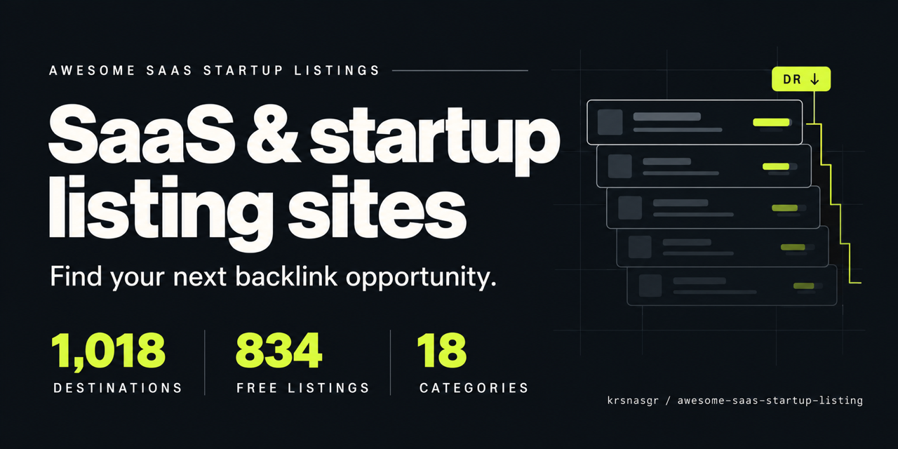

# Awesome SaaS & Startup Directories: Free Backlinks & Domain Rating

Find startup directories, SaaS listing sites and free backlink opportunities for your link building research. Compare **1,020 destinations** by pricing, reported Ahrefs Domain Rating (DR), and dofollow or nofollow link type, with the **highest DR first** in every listing table.

**1,020 exact links · 18 categories · 836 free listings · Updated: 2026-10-31**

Original archive: 1,018 entries captured 2026-10-26. [Latest addition: BuzzLaunches — verified badge required for free dofollow](docs/ADDITIONS.md#buzzlaunches). The cover image shows the original archive totals.

Looking to **increase Domain Rating**, find **free dofollow backlinks**, or submit your SaaS to **high-DR directories**? Start with the filtered shortlists below and the [guide to increasing DR](docs/INCREASE-DOMAIN-RATING.md). This archive includes launch platforms, communities and software review sites as well as directories. [Contributions and corrections are welcome](CONTRIBUTING.md).

## Contents

- [Start here](#start-here)
- [How to increase Domain Rating with directory listings](#how-to-increase-domain-rating-with-directory-listings)
- [Browse by category](#browse-by-category)
- [Reading an entry](#reading-an-entry)
- [Full catalog](#full-catalog)
  - [AI Tools](#ai-tools)
  - [Community](#community)
  - [Deals / SaaS](#deals-saas)
  - [Design Tools](#design-tools)
  - [Developer Tools](#developer-tools)
  - [General Directory](#general-directory)
  - [Indie Hackers](#indie-hackers)
  - [Launchpad](#launchpad)
  - [Marketing Tools](#marketing-tools)
  - [Marketplace](#marketplace)
  - [No-Code](#no-code)
  - [Open Source](#open-source)
  - [Productivity](#productivity)
  - [SaaS Tools](#saas-tools)
  - [Software Discovery](#software-discovery)
  - [Software Reviews](#software-reviews)
  - [Startup Directory](#startup-directory)
  - [Tech / Startups](#tech-startups)
- [Use the list well](#use-the-list-well)
- [Coverage and integrity](#coverage-and-integrity)
- [Downloads and maintenance](#downloads-and-maintenance)

## Start here

| View | Entries |
| --- | ---: |
| [Free startup directories](views/free-startup-directories.md) | 836 |
| [Freemium startup directories](views/freemium-startup-directories.md) | 45 |
| [Paid startup directories](views/paid-startup-directories.md) | 139 |
| [Dofollow startup directories](views/dofollow-startup-directories.md) | 596 |
| [Nofollow startup directories](views/nofollow-startup-directories.md) | 421 |
| [Conditional link types](views/conditional-links.md) | 3 |
| [Free dofollow startup directories](views/free-dofollow-startup-directories.md) | 459 |
| [Free dofollow directories with DR 50+](views/free-dofollow-dr-50-plus.md) | 179 |

**Browse by DR:** [30+](views/dr-30-plus.md) · [50+](views/dr-50-plus.md) · [70+](views/dr-70-plus.md) · [90+](views/dr-90-plus.md). [All 14 filters](views/README.md) · [CSV](data/directories.csv) · [JSON](data/directories.json).

> Pricing, DR and link labels are reported snapshot values—not a current audit or a promise of free backlinks, a DR boost, rankings or acceptance. Communities, media outlets and non-SaaS destinations remain included for completeness. Check eligibility before submitting.

## How to increase Domain Rating with directory listings

Use this catalog to research relevant places to list your startup and earn backlinks. For a focused shortlist, browse [free dofollow directories with DR 50+](views/free-dofollow-dr-50-plus.md), [high-DR sites at 70+](views/dr-70-plus.md), or [all free listing sites](views/free-startup-directories.md).

Ahrefs calculates DR from a domain's backlink profile; the referring site's DR and how many domains it links to both matter. A high-DR directory alone cannot predict your increase. [Ahrefs explains the calculation](https://help.ahrefs.com/en/articles/1409408-what-is-domain-rating-dr).

Check product fit, current submission terms and the actual published link before recording a result. Read the [free backlinks and directory submission guide](docs/INCREASE-DOMAIN-RATING.md) for a workflow and answers about dofollow links, free submissions and DR growth.

## Browse by category

Each archive entry appears once in the full catalog. Open a focused category page below, or jump to its section in this README.

| Category | Entries | On this page |
| --- | ---: | --- |
| [AI Tools](categories/ai-tools.md) | 121 | [Browse below](#ai-tools) |
| [Community](categories/community.md) | 147 | [Browse below](#community) |
| [Deals / SaaS](categories/deals-saas.md) | 6 | [Browse below](#deals-saas) |
| [Design Tools](categories/design-tools.md) | 46 | [Browse below](#design-tools) |
| [Developer Tools](categories/developer-tools.md) | 5 | [Browse below](#developer-tools) |
| [General Directory](categories/general-directory.md) | 305 | [Browse below](#general-directory) |
| [Indie Hackers](categories/indie-hackers.md) | 13 | [Browse below](#indie-hackers) |
| [Launchpad](categories/launchpad.md) | 33 | [Browse below](#launchpad) |
| [Marketing Tools](categories/marketing-tools.md) | 3 | [Browse below](#marketing-tools) |
| [Marketplace](categories/marketplace.md) | 10 | [Browse below](#marketplace) |
| [No-Code](categories/no-code.md) | 2 | [Browse below](#no-code) |
| [Open Source](categories/open-source.md) | 5 | [Browse below](#open-source) |
| [Productivity](categories/productivity.md) | 2 | [Browse below](#productivity) |
| [SaaS Tools](categories/saas-tools.md) | 21 | [Browse below](#saas-tools) |
| [Software Discovery](categories/software-discovery.md) | 114 | [Browse below](#software-discovery) |
| [Software Reviews](categories/software-reviews.md) | 23 | [Browse below](#software-reviews) |
| [Startup Directory](categories/startup-directory.md) | 9 | [Browse below](#startup-directory) |
| [Tech / Startups](categories/tech-startups.md) | 155 | [Browse below](#tech-startups) |

## Reading an entry

Every listing appears in a table with **Listing, Pricing, DR and Link type** columns. The listing name links to the exact destination URL. All listing tables sort by descending DR, then name A–Z for ties. Category sections remain A–Z.

- **Pricing:** `Free`, `Freemium` or `Paid`, as recorded in the snapshot. A free account does not necessarily mean every listing feature is free.
- **DR:** the reported Ahrefs score at capture, not a live lookup or a prediction for your own website.
- **Link type:** `Dofollow`, `Nofollow` or `Conditional`. Conditional is never counted as guaranteed dofollow.
- **Scope:** exact paths and original spellings are retained. Same-domain groups and submission pages are separate entries.

Entries use factual metadata instead of copied reviews or unverified promotional descriptions. See [methodology](docs/METHODOLOGY.md) for details.

## Full catalog

### AI Tools

121 entries · [Focused page](categories/ai-tools.md) · [Back to contents](#contents)

Discovery catalogs and launch surfaces focused on artificial-intelligence products.

Explore also: [Software Discovery](#software-discovery) · [Developer Tools](#developer-tools).

| Listing | Pricing | DR¹ | Link type¹ |
| --- | --- | --- | --- |
| [Neil Patel AI Tools Directory](<https://neilpatel.com/ai-tools/>) | Free | 91 | Nofollow |
| [Dang.ai](<https://dang.ai>) | Free | 83 | Nofollow |
| [ToolPilot.ai](<https://toolpilot.ai>) | Free | 79 | Dofollow |
| [There's An AI For That](<https://theresanaiforthat.com>) | Freemium | 78 | Nofollow |
| [Submit AI Tools](<https://submitaitools.org>) | Free | 76 | Nofollow |
| [Good AI Tools](<https://goodaitools.com>) | Free | 75 | Dofollow |
| [MedSci AI](<https://aisite.medsci.cn>) | Free | 74 | Dofollow |
| [What's the Big Data](<https://whatsthebigdata.com>) | Paid | 74 | Nofollow |
| [Futurepedia](<https://futurepedia.io>) | Free | 73 | Dofollow |
| [Magai's AI Library](<https://magai.co/ai-tools>) | Free | 73 | Nofollow |
| [AIbase](<https://aibase.com>) | Free | 72 | Dofollow |
| [Supertools](<https://supertools.therundown.ai>) | Free | 72 | Dofollow |
| [Toolify.ai](<https://toolify.ai>) | Freemium | 72 | Dofollow |
| [AI Directories](<https://aidirectori.es>) | Freemium | 71 | Dofollow |
| [Acid Tools](<https://acidtools.com>) | Free | 70 | Nofollow |
| [Future Tools](<https://futuretools.io>) | Free | 70 | Nofollow |
| [OpenTools](<https://opentools.ai>) | Free | 68 | Nofollow |
| [Ben's Bites](<https://bensbites.com>) | Free | 67 | Nofollow |
| [TopAI.tools](<https://topai.tools>) | Freemium | 65 | Dofollow |
| [AI Tool Trek](<https://aitooltrek.com>) | Free | 63 | Dofollow |
| [Altern](<https://altern.ai>) | Free | 63 | Nofollow |
| [ToolsFine](<https://toolsfine.com>) | Free | 63 | Dofollow |
| [Easy With AI](<https://easywithai.com>) | Paid | 61 | Dofollow |
| [DailyBot AI](<https://dailybot.com/ai-tools>) | Free | 60 | Dofollow |
| [AI With Me](<https://aiwith.me>) | Free | 58 | Dofollow |
| [AI X Collection](<https://aixcollection.com>) | Free | 58 | Dofollow |
| [Aithor AI Directory](<https://aithor.com/directory>) | Free | 58 | Dofollow |
| [lbbai](<https://lbbai.com>) | Free | 58 | Dofollow |
| [Aitoolnet](<https://aitoolnet.com>) | Free | 57 | Dofollow |
| [AITopTools](<https://aitoptools.com>) | Free | 57 | Nofollow |
| [AIxploria](<https://aixploria.com>) | Free | 57 | Nofollow |
| [Appa List](<https://appalist.com>) | Free | 56 | Dofollow |
| [Launch (trylaunch.ai)](<https://trylaunch.ai>) | Free | 56 | Nofollow |
| [AI Tech Viral](<https://aitechviral.com>) | Free | 55 | Nofollow |
| [AIToolHunt](<https://aitoolhunt.com>) | Free | 55 | Dofollow |
| [GodOfPrompt AI Tools](<https://www.godofprompt.ai/ai-tools-list>) | Free | 55 | Nofollow |
| [Saas AI Tools](<https://saasaitools.com>) | Free | 54 | Dofollow |
| [AI Tools Directory](<https://aitoolsdirectory.com>) | Free | 51 | Nofollow |
| [Power Up Tools](<https://poweruptools.com>) | Free | 50 | Dofollow |
| [ToolDirectory.ai](<https://tooldirectory.ai>) | Free | 50 | Nofollow |
| [OpenFuture AI](<https://openfuture.ai>) | Free | 49 | Nofollow |
| [108AI](<https://www.108ai.com>) | Free | 48 | Nofollow |
| [300+ Best AI Tools](<https://www.insidr.ai/ai-tools>) | Free | 48 | Dofollow |
| [AIGC 160](<https://aigc160.com>) | Free | 48 | Dofollow |
| [Insidr.ai](<https://insidr.ai>) | Freemium | 48 | Dofollow |
| [Phygital+ AI Library](<https://phygital.plus>) | Free | 47 | Nofollow |
| [SaaS Field](<https://saasfield.com>) | Free | 47 | Dofollow |
| [Tool Find Dir](<https://toolfinddir.com>) | Free | 47 | Dofollow |
| [TipSeason](<https://tipseason.com>) | Free | 46 | Dofollow |
| [AI Scout](<https://aiscout.net>) | Free | 43 | Dofollow |
| [aitools.fyi](<https://aitools.fyi>) | Free | 43 | Nofollow |
| [BestofAI](<https://bestofai.com>) | Free | 43 | Nofollow |
| [Super AI Boom](<https://superaiboom.com>) | Free | 43 | Dofollow |
| [AI Launch Space](<https://ailaunch.space>) | Free | 42 | Dofollow |
| [The Key Tools](<https://thekeytools.com>) | Free | 42 | Dofollow |
| [Tool Prism](<https://toolprism.com>) | Free | 42 | Dofollow |
| [Latest AI Updates](<https://latestaiupdates.com>) | Free | 41 | Dofollow |
| [The App Tools](<https://theapptools.com>) | Free | 41 | Dofollow |
| [Startup AIdeas](<https://startupaideas.com>) | Free | 40 | Dofollow |
| [TEXTIFY](<https://textify.ai/directory>) | Free | 40 | Dofollow |
| [LLM Relevance](<https://llmrelevance.com>) | Free | 39 | Dofollow |
| [Hot100.ai](<https://hot100.ai>) | Free | 38 | Nofollow |
| [Victrays](<https://victrays.com>) | Paid | 38 | Dofollow |
| [AI Tool Details](<https://chatgptdemo.com>) | Free | 36 | Dofollow |
| [AISuperHub](<https://www.aisuperhub.io>) | Free | 36 | Nofollow |
| [AI Valley](<https://aivalley.ai>) | Free | 35 | Nofollow |
| [RankYourAI](<https://rankyourai.com>) | Paid | 35 | Dofollow |
| [TopTools.ai](<https://toptools.ai>) | Free | 33 | Nofollow |
| [ToolsClaw](<https://toolsclaw.com>) | Freemium | 32 | Dofollow |
| [GPTE](<https://gpte.ai>) | Free | 31 | Dofollow |
| [AI Tool Guru](<https://aitoolguru.com>) | Free | 30 | Nofollow |
| [NaNAI.tools](<https://nanai.tools>) | Free | 29 | Dofollow |
| [AI Center](<https://ai-center.com>) | Paid | 27 | Dofollow |
| [aiwizard](<https://www.aiwizard.ai>) | Free | 27 | Dofollow |
| [AiToolex](<https://aitoolex.com>) | Free | 26 | Dofollow |
| [ki-suche.io](<https://ki-suche.io>) | Free | 26 | Dofollow |
| [SaaSBaba](<https://saasbaba.com>) | Free | 26 | Nofollow |
| [ToolList.ai](<https://toollist.ai>) | Free | 25 | Dofollow |
| [Owwly](<https://owwly.com>) | Free | 24 | Nofollow |
| [Startup AI Tools](<https://startupaitools.com>) | Paid | 22 | Dofollow |
| [AI-Hunter.io](<https://ai-hunter.io>) | Free | 21 | Dofollow |
| [Made with Bolt](<https://madewithbolt.com>) | Free | 21 | Nofollow |
| [AI Demos](<https://aidemos.com>) | Free | 18 | Nofollow |
| [AIArt.Tools](<https://aiart.tools>) | Free | 18 | Dofollow |
| [Igniter AI](<https://www.igniter.ai>) | Free | 16 | Dofollow |
| [Mad Genius](<https://madgenius.co>) | Free | 15 | Dofollow |
| [NextPedia](<https://nextpedia.io>) | Free | 14 | Dofollow |
| [The AI Warehouse](<https://www.thewarehouse.ai>) | Free | 14 | Dofollow |
| [AI Directory](<https://aidirectory.com>) | Free | 13 | Nofollow |
| [AI Navbar](<https://ainavbar.ai>) | Free | 13 | Dofollow |
| [aifeed.dev](<https://aifeed.dev>) | Free | 13 | Nofollow |
| [AI Awesome](<https://www.aiawesome.com>) | Free | 12 | Dofollow |
| [AItoGrow](<https://aitogrow.com>) | Free | 12 | Nofollow |
| [aier.im](<https://aier.im>) | Free | 11 | Dofollow |
| [Discover the best artificial intelligence tools](<https://www.toolsnocode.com/ai>) | Free | 11 | Dofollow |
| [AI Finder](<https://ai-finder.net>) | Free | 10 | Dofollow |
| [The Ultimate ChatGPT Database](<https://www.chataiapps.com>) | Free | 10 | Dofollow |
| [YAATD](<https://yaatd.com>) | Free | 10 | Nofollow |
| [AI Stash](<https://www.aistash.co>) | Free | 9 | Dofollow |
| [Future AGI Tools](<https://www.futureagitools.com>) | Free | 9 | Dofollow |
| [AI Toolz](<https://aitoolz.com>) | Free | 8 | Dofollow |
| [AITooly](<https://aitooly.com>) | Freemium | 6 | Dofollow |
| [VercelAPP](<https://vercelapp.com>) | Free | 5 | Dofollow |
| [EasyWithAI](<https://easywith.ai>) | Free | 4 | Dofollow |
| [ToolPilot AI](<https://toolpilot.com>) | Free | 4 | Nofollow |
| [AI Collection (That AI Collection)](<https://aicollection.io>) | Paid | 3 | Dofollow |
| [Toolsummary](<https://toolsummary.com>) | Free | 3 | Nofollow |
| [AI Marketing Directory](<https://aimarketingdirectory.com>) | Free | 2 | Nofollow |
| [AI Generation](<https://aigeneration.com>) | Free | 0 | Dofollow |
| [AI Tools Mafia](<https://aitoolsmafia.com>) | Freemium | 0 | Dofollow |
| [AI Tools Tracker](<https://aitoolstracker.com>) | Free | 0 | Dofollow |
| [EveryAI](<https://everyai.com>) | Free | 0 | Dofollow |
| [Free AI Tools Directory](<https://freeaitools.directory>) | Free | 0 | Nofollow |
| [GPTAcademy](<https://gptacademy.com>) | Free | 0 | Nofollow |
| [Hack the Prompt](<https://hackthe-prompt.com>) | Free | 0 | Nofollow |
| [IndieHunt](<https://indiehunt.com>) | Free | 0 | Dofollow |
| [Mars AI Directory](<https://marsai.info>) | Free | 0 | Dofollow |
| [NetlifyAPP](<https://netlifyapp.com>) | Free | 0 | Dofollow |
| [NextGen Tools](<https://nextgentools.io>) | Free | 0 | Dofollow |
| [Tools AI Online](<https://toolsaionline.com>) | Free | 0 | Nofollow |
| [ToolScoutAPI](<https://toolscoutapi.com>) | Free | 0 | Nofollow |

### Community

147 entries · [Focused page](categories/community.md) · [Back to contents](#contents)

Forums, groups, chat servers and participation-led communities. Read each community’s rules; a presence here is not permission to promote.

Explore also: [Indie Hackers](#indie-hackers) · [Tech / Startups](#tech-startups).

| Listing | Pricing | DR¹ | Link type¹ |
| --- | --- | --- | --- |
| [Band of Entrepreneurs](<https://www.linkedin.com/groups/1789386>) | Free | 99 | Nofollow |
| [Entrepreneur's Network](<https://www.linkedin.com/groups/91749>) | Free | 99 | Nofollow |
| [Executive Suite](<https://www.linkedin.com/groups/1426>) | Free | 99 | Nofollow |
| [On Startups](<https://www.linkedin.com/groups/2877>) | Free | 99 | Nofollow |
| [Startup Specialists Group](<https://www.linkedin.com/groups/56766>) | Free | 99 | Nofollow |
| [Furlough](<https://discord.com/invite/UrFqwSwxvN>) | Free | 95 | Nofollow |
| [Loqol Startup Community](<https://discord.gg/79X3j8NHGE>) | Free | 95 | Nofollow |
| [Makers Community](<https://discord.gg/zvE8QjdWaf>) | Free | 95 | Nofollow |
| [Makers HQ](<https://discord.com/invite/zvE8QjdWaf>) | Free | 95 | Nofollow |
| [Makerspace](<https://discord.gg/GvTmqCZygz>) | Free | 95 | Nofollow |
| [OpenAI discord Server](<https://discord.gg/openai>) | Free | 95 | Nofollow |
| [r/advancedentrepreneur/](<https://www.reddit.com/r/advancedentrepreneur>) | Free | 95 | Nofollow |
| [r/Advertising](<https://reddit.com/r/Advertising>) | Free | 95 | Nofollow |
| [r/AlphaandBetausers](<https://www.reddit.com/r/alphaandbetausers>) | Free | 95 | Nofollow |
| [r/ArtificialInteligence/](<https://www.reddit.com/r/ArtificialInteligence>) | Free | 95 | Nofollow |
| [r/AskMarketing](<https://reddit.com/r/AskMarketing>) | Free | 95 | Nofollow |
| [r/betatests](<https://www.reddit.com/r/betatests>) | Free | 95 | Nofollow |
| [r/Business_Ideas](<https://reddit.com/r/Business_Ideas>) | Free | 95 | Nofollow |
| [r/Businessideas](<https://reddit.com/r/Businessideas>) | Free | 95 | Nofollow |
| [r/coupons](<https://reddit.com/r/coupons>) | Free | 95 | Nofollow |
| [r/design](<https://reddit.com/r/design>) | Free | 95 | Nofollow |
| [r/design_critiques/](<https://www.reddit.com/r/design_critiques>) | Free | 95 | Nofollow |
| [r/DotCom](<https://www.reddit.com/r/DotCom>) | Free | 95 | Nofollow |
| [r/eCommerce](<https://reddit.com/r/eCommerce>) | Free | 95 | Nofollow |
| [r/EmailMarketing](<https://reddit.com/r/EmailMarketing>) | Free | 95 | Nofollow |
| [r/Entrepreneur](<https://reddit.com/r/Entrepreneur>) | Free | 95 | Nofollow |
| [r/EntrepreneurRideAlong/](<https://www.reddit.com/r/EntrepreneurRideAlong>) | Free | 95 | Nofollow |
| [r/entrepreneurship](<https://reddit.com/r/entrepreneurship>) | Free | 95 | Nofollow |
| [r/frontend](<https://reddit.com/r/frontend>) | Free | 95 | Nofollow |
| [r/growinpublic](<https://www.reddit.com/r/growinpublic>) | Free | 95 | Nofollow |
| [r/GrowMyBusiness](<https://www.reddit.com/r/growmybusiness>) | Free | 95 | Nofollow |
| [r/GrowthHacking/](<https://www.reddit.com/r/GrowthHacking>) | Free | 95 | Nofollow |
| [r/IMadeThis/](<https://www.reddit.com/r/IMadeThis>) | Free | 95 | Nofollow |
| [r/indiebiz/](<https://www.reddit.com/r/indiebiz>) | Free | 95 | Nofollow |
| [r/indiehackers/](<https://www.reddit.com/r/indiehackers>) | Free | 95 | Nofollow |
| [r/InternetIsBeautiful/](<https://www.reddit.com/r/InternetIsBeautiful>) | Free | 95 | Nofollow |
| [r/ladybusiness/](<https://www.reddit.com/r/ladybusiness>) | Free | 95 | Nofollow |
| [r/Marketing](<https://reddit.com/r/marketing>) | Free | 95 | Nofollow |
| [r/microsaas/](<https://www.reddit.com/r/microsaas>) | Free | 95 | Nofollow |
| [r/NicheWebsites/](<https://www.reddit.com/r/NicheWebsites>) | Free | 95 | Nofollow |
| [r/nocode/](<https://www.reddit.com/r/nocode>) | Free | 95 | Nofollow |
| [r/NoCodeSaaS/](<https://reddit.com/r/NoCodeSaaS>) | Free | 95 | Nofollow |
| [r/Plugyourproduct/](<https://www.reddit.com/r/plugyourproduct>) | Free | 95 | Nofollow |
| [r/ProductHunters/](<https://www.reddit.com/r/ProductHunters>) | Free | 95 | Nofollow |
| [r/programming](<https://reddit.com/r/programming>) | Free | 95 | Nofollow |
| [r/Retail](<https://reddit.com/r/Retail>) | Free | 95 | Nofollow |
| [r/roastmystartup/](<https://www.reddit.com/r/roastmystartup>) | Free | 95 | Nofollow |
| [r/SaaS/](<https://www.reddit.com/r/SaaS>) | Free | 95 | Nofollow |
| [r/Sales](<https://reddit.com/r/Sales>) | Free | 95 | Nofollow |
| [r/sideproject](<https://www.reddit.com/r/sideproject>) | Free | 95 | Nofollow |
| [r/Socialpreneur](<https://www.reddit.com/r/Socialpreneur>) | Free | 95 | Nofollow |
| [r/startup](<https://reddit.com/r/startup>) | Free | 95 | Nofollow |
| [r/Startup_Ideas/](<https://www.reddit.com/r/Startup_Ideas>) | Free | 95 | Nofollow |
| [r/startup_resources](<https://reddit.com/r/startup_resources>) | Free | 95 | Nofollow |
| [r/startups/](<https://www.reddit.com/r/startups>) | Free | 95 | Nofollow |
| [r/streetwearstartup](<https://reddit.com/r/streetwearstartup>) | Free | 95 | Nofollow |
| [r/SweatyStartup](<https://www.reddit.com/r/sweatystartup>) | Free | 95 | Nofollow |
| [r/technology](<https://reddit.com/r/technology>) | Free | 95 | Nofollow |
| [r/testmyapp](<https://www.reddit.com/r/TestMyApp>) | Free | 95 | Nofollow |
| [r/thesidehustle/](<https://reddit.com//r/thesidehustle>) | Free | 95 | Nofollow |
| [r/userexperience](<https://reddit.com/r/userexperience>) | Free | 95 | Nofollow |
| [r/VentureCapital](<https://reddit.com/r/VentureCapital>) | Free | 95 | Nofollow |
| [r/VenturedCapital](<https://reddit.com/r/VenturedCapital>) | Free | 95 | Nofollow |
| [r/webdesign](<https://reddit.com/r/webdesign>) | Free | 95 | Nofollow |
| [r/WebMarketing](<https://reddit.com/r/WebMarketing>) | Free | 95 | Nofollow |
| [Reddit](<https://reddit.com>) | Free | 95 | Nofollow |
| [Retool Discord Server](<https://discord.com/invite/aEHwpVd7yF>) | Free | 95 | Nofollow |
| [Startup India](<https://discord.gg/jtESvh9Pg5>) | Free | 95 | Nofollow |
| [Stripe](<https://stripe.com/en-in/partner-proqram>) | Free | 95 | Nofollow |
| [Stripe Discord Server](<https://discord.gg/stripe>) | Free | 95 | Nofollow |
| [Tech Startup Community](<https://discord.com/invite/gyUKVDGGC6>) | Free | 95 | Nofollow |
| [Women in Technology](<http://witchat.github.io>) | Free | 94 | Nofollow |
| [Atlassian](<https://www.atlassian.com/blog/trello/trello-collection-atlassian-community>) | Free | 92 | Nofollow |
| [Quora](<https://quora.com>) | Free | 92 | Nofollow |
| [DEV Community](<https://dev.to>) | Free | 91 | Dofollow |
| [Glassdoor](<https://glassdoor.com>) | Freemium | 91 | Nofollow |
| [HackerNews](<https://news.ycombinator.com/showhn.html>) | Free | 91 | Nofollow |
| [Firebase](<https://firebase-community.appspot.com>) | Free | 90 | Nofollow |
| [FreeCodeCamp](<https://forum.freecodecamp.org>) | Free | 89 | Nofollow |
| [TechRepublic](<https://www.techrepublic.com>) | Free | 89 | Nofollow |
| [Devpost](<https://devpost.com/software>) | Free | 88 | Nofollow |
| [Cloud Native Computing Foundation](<https://slack.cncf.io>) | Free | 86 | Nofollow |
| [SitePoint Forums](<https://www.sitepoint.com/community>) | Free | 86 | Nofollow |
| [Babel Slack](<https://slack.babeljs.io>) | Free | 85 | Nofollow |
| [F6S](<https://f6s.com>) | Free | 83 | Nofollow |
| [Hashnode](<https://hashnode.com>) | Free | 83 | Nofollow |
| [MarketingProfs](<https://www.marketingprofs.com>) | Free | 83 | Nofollow |
| [Startup Digest: More Than Just a Newsletter \| Techstars](<https://www.techstars.com/communities/startup-digest>) | Free | 83 | Nofollow |
| [Indie Hackers](<https://indiehackers.com>) | Free | 82 | Nofollow |
| [Biggerpockets.com](<https://biggerpockets.com>) | Free | 80 | Nofollow |
| [People Ops & HR Community](<https://lattice.com/community/rfh>) | Free | 79 | Nofollow |
| [Peerlist](<https://peerlist.io>) | Free | 78 | Dofollow |
| [Growth Hackers](<https://growthhackers.com>) | Free | 77 | Nofollow |
| [Startup Grind](<https://www.startupgrind.com>) | Free | 77 | Nofollow |
| [Lobsters](<https://lobste.rs>) | Free | 76 | Dofollow |
| [Mind the product](<http://slack.mindtheproduct.com>) | Free | 76 | Nofollow |
| [Cloud Foundry](<https://slack.cloudfoundry.org>) | Free | 75 | Nofollow |
| [Product School](<https://www.productschool.com/slack-community>) | Free | 75 | Nofollow |
| [Data Quest](<https://www.dataquest.io/chat>) | Free | 74 | Nofollow |
| [DevDojo](<https://devdojo.com>) | Free | 74 | Nofollow |
| [eCommerceFuel](<https://www.ecommercefuel.com>) | Free | 73 | Nofollow |
| [Fark](<https://www.fark.com>) | Free | 73 | Dofollow |
| [Product-Led Alliance](<https://www.productledalliance.com>) | Free | 70 | Nofollow |
| [Designer News](<https://www.designernews.co>) | Free | 69 | Nofollow |
| [Stacker News](<https://stacker.news>) | Free | 65 | Dofollow |
| [DailyPings](<https://dailypings.com>) | Free | 63 | Nofollow |
| [Online Geniuses](<https://onlinegeniuses.com/marketplace>) | Free | 63 | Nofollow |
| [CoFoundersLab](<https://cofounderslab.com>) | Free | 61 | Nofollow |
| [Pinkary](<https://pinkary.com>) | Free | 58 | Dofollow |
| [devRant](<https://devrant.com>) | Free | 57 | Nofollow |
| [Elpha](<https://elpha.com>) | Free | 57 | Nofollow |
| [Remote Tools](<https://www.remote.tools>) | Free | 56 | Nofollow |
| [Fastlane Forum](<https://www.thefastlaneforum.com/community>) | Free | 52 | Nofollow |
| [No Code Founders](<https://nocodefounders.com>) | Free | 51 | Nofollow |
| [Product HQ](<https://www.productmanagerhq.com/join-the-community>) | Free | 49 | Nofollow |
| [The Hive Index](<https://thehiveindex.com>) | Free | 49 | Nofollow |
| [Outreach Desk](<https://outreachdesk.com>) | Free | 48 | Nofollow |
| [Creative Tribes](<http://creativetribes.co>) | Free | 46 | Nofollow |
| [Unita](<https://unita.co>) | Free | 46 | Nofollow |
| [Builders.to](<https://builders.to>) | Free | 43 | Dofollow |
| [Make.rs](<https://make.rs>) | Free | 40 | Nofollow |
| [Front-end Developers](<http://frontenddevelopers.org>) | Free | 39 | Nofollow |
| [iOS Developers](<https://ios-developers.io>) | Free | 38 | Nofollow |
| [Remotely One](<https://www.remotelyone.com>) | Free | 38 | Nofollow |
| [founderio](<https://www.founderio.com>) | Free | 36 | Nofollow |
| [Growmance](<https://audienti.com/growmance>) | Free | 36 | Nofollow |
| [Landscape](<https://www.landscape.vc/community>) | Free | 34 | Nofollow |
| [GenZ VCs](<https://www.genzvcs.com/join-us>) | Free | 32 | Nofollow |
| [Kernal](<https://kern.al>) | Free | 31 | Nofollow |
| [FoundersList](<https://founderslist.com>) | Free | 28 | Nofollow |
| [WeAreNoCode](<https://www.wearenocode.com>) | Free | 28 | Nofollow |
| [IndieMaker](<https://indiemaker.co>) | Free | 23 | Nofollow |
| [SEOUL Startups](<https://www.seoulstartups.com>) | Free | 20 | Nofollow |
| [#TechMasters](<https://techmasters.chat>) | Free | 17 | Nofollow |
| [Android United](<http://android-united.community>) | Free | 17 | Nofollow |
| [Startup Chat](<https://community.startup.foundation/c/latest>) | Free | 16 | Nofollow |
| [Broadwise.org](<https://broadwise.org>) | Free | 14 | Nofollow |
| [TechLondon](<https://techlondon.io>) | Free | 14 | Nofollow |
| [Belkins B2B Sales](<https://blkns.co>) | Free | 11 | Nofollow |
| [Indie London](<https://www.indielondon.co>) | Free | 10 | Nofollow |
| [Silicon Prairie Tech](<http://siliconprairietech.com/invite>) | Free | 10 | Nofollow |
| [The TechMap](<https://thetechmap.com>) | Free | 10 | Nofollow |
| [indiehacker.tools](<https://indiehacker.tools>) | Free | 9 | Nofollow |
| [Microsoft Dev Chat](<http://msdev.chat>) | Free | 9 | Nofollow |
| [Snowball club](<https://snowballclub.com>) | Free | 9 | Nofollow |
| [Hackers Pad](<https://hackerspad.net>) | Free | 8 | Nofollow |
| [Founderopedia](<https://founderopedia.com>) | Free | 3 | Nofollow |

### Deals / SaaS

6 entries · [Focused page](categories/deals-saas.md) · [Back to contents](#contents)

Deal-oriented discovery for software businesses. Check commercial terms and whether your product fits the audience.

Explore also: [SaaS Tools](#saas-tools) · [Software Reviews](#software-reviews).

| Listing | Pricing | DR¹ | Link type¹ |
| --- | --- | --- | --- |
| [AppSumo](<https://appsumo.com>) | Paid | 83 | Conditional |
| [StackSocial](<https://stacksocial.com>) | Paid | 73 | Nofollow |
| [SaaSPirate](<https://saaspirate.com>) | Freemium | 66 | Dofollow |
| [DealMirror](<https://dealmirror.com>) | Paid | 49 | Nofollow |
| [PitchGround](<https://pitchground.com>) | Paid | 47 | Nofollow |
| [SaaS Mantra](<https://www.saasmantra.com>) | Paid | 35 | Nofollow |

### Design Tools

46 entries · [Focused page](categories/design-tools.md) · [Back to contents](#contents)

Design discovery, resources and showcases. Some entries require a design asset or portfolio rather than a generic SaaS listing.

Explore also: [Marketplace](#marketplace) · [Software Discovery](#software-discovery).

| Listing | Pricing | DR¹ | Link type¹ |
| --- | --- | --- | --- |
| [Behance](<https://behance.net>) | Free | 94 | Nofollow |
| [Dribbble](<https://dribbble.com>) | Freemium | 93 | Nofollow |
| [Awwwards](<https://www.awwwards.com>) | Paid | 89 | Nofollow |
| [Css Design Awards](<https://www.cssdesignawards.com/submit>) | Paid | 80 | Dofollow |
| [One Page Love](<https://onepagelove.com>) | Paid | 79 | Nofollow |
| [Designspiration](<https://www.designspiration.com>) | Free | 77 | Nofollow |
| [SiteInspire](<https://www.siteinspire.com>) | Free | 76 | Nofollow |
| [CSS Winner](<https://www.csswinner.com/submitsite>) | Paid | 75 | Dofollow |
| [Landbook](<https://land-book.com>) | Free | 73 | Nofollow |
| [Freebie Supply](<https://freebiesupply.com>) | Free | 72 | Dofollow |
| [Ecomm Design](<https://ecomm.design/submit>) | Free | 71 | Dofollow |
| [Layers.to](<https://layers.to>) | Free | 71 | Dofollow |
| [Craftwork.design](<https://craftwork.design>) | Free | 69 | Dofollow |
| [Web Design Inspiration](<https://webdesign-inspiration.com>) | Free | 66 | Dofollow |
| [Landingfolio](<https://landingfolio.com>) | Paid | 65 | Dofollow |
| [Godly](<https://godly.website/info>) | Free | 64 | Dofollow |
| [Webguru Awards](<https://www.webguruawards.com/site-submit>) | Free | 63 | Dofollow |
| [Unmatched Style](<http://unmatchedstyle.com/submit>) | Free | 62 | Dofollow |
| [CSS Nectar](<https://cssnectar.com/suggest-site>) | Paid | 60 | Dofollow |
| [Web Designer News](<https://webdesignernews.com>) | Free | 59 | Dofollow |
| [Admire The Web](<https://admiretheweb.com>) | Paid | 58 | Nofollow |
| [Built At Lightspeed](<https://www.builtatlightspeed.com>) | Free | 57 | Dofollow |
| [SaaS Landing Page](<https://saaslandingpage.com>) | Free | 54 | Dofollow |
| [Commerce Cream](<https://commercecream.com>) | Free | 48 | Dofollow |
| [Frameplate](<https://frameplate.co>) | Free | 48 | Dofollow |
| [TOOOLS.design](<https://toools.design>) | Free | 48 | Nofollow |
| [Dead Simple Sites](<https://deadsimplesites.com>) | Free | 46 | Dofollow |
| [Design spells](<https://www.designspells.com>) | Free | 46 | Dofollow |
| [Fuse.kiwi](<https://www.fuse.kiwi>) | Free | 46 | Dofollow |
| [Dark](<https://www.dark.design>) | Free | 45 | Dofollow |
| [UI Goodies](<https://uigoodies.com>) | Paid | 43 | Dofollow |
| [Tailkits.com](<https://tailkits.com>) | Free | 42 | Dofollow |
| [Dark Mode Design](<https://www.darkmodedesign.com>) | Free | 40 | Dofollow |
| [PFolios](<https://pfolios.net>) | Free | 40 | Dofollow |
| [Flat Ui](<https://flatui.com/submit-flat-ui-designs>) | Free | 35 | Dofollow |
| [Deck Gallery](<https://www.deck.gallery>) | Free | 34 | Dofollow |
| [We &lt;3 Wordpress](<https://welovewp.com/submit>) | Paid | 33 | Dofollow |
| [Cartcraze](<https://cartcraze.com/submit>) | Free | 31 | Dofollow |
| [Landing Pages](<https://www.landingpage.fyi>) | Free | 31 | Dofollow |
| [Storefront Design](<https://www.storefront.design>) | Free | 26 | Dofollow |
| [TemplateFame](<https://templatefame.com>) | Free | 26 | Dofollow |
| [Best Web Design Tools](<https://bestwebdesigntools.com>) | Paid | 20 | Dofollow |
| [Flat Trendz](<https://flattrendz.com/submit-a-site>) | Paid | 20 | Dofollow |
| [Neede](<https://neede.co>) | Free | 14 | Dofollow |
| [Saas Css](<https://saascss.com/submit>) | Free | 11 | Dofollow |
| [Spectacular Web](<https://spectacular.so>) | Free | 0 | Dofollow |

### Developer Tools

5 entries · [Focused page](categories/developer-tools.md) · [Back to contents](#contents)

Places centered on developer-facing products and technical audiences.

Explore also: [Open Source](#open-source) · [No-Code](#no-code).

| Listing | Pricing | DR¹ | Link type¹ |
| --- | --- | --- | --- |
| [Stack Overflow](<https://stackoverflow.com>) | Free | 92 | Nofollow |
| [Pipedream Sources](<https://pipedream.com/apps>) | Free | 83 | Nofollow |
| [Stackshare](<https://stackshare.io>) | Free | 78 | Dofollow |
| [DevHunt](<https://devhunt.org>) | Free | 68 | Dofollow |
| [PublicAPIs.dev](<https://publicapis.dev>) | Free | 47 | Dofollow |

### General Directory

305 entries · [Focused page](categories/general-directory.md) · [Back to contents](#contents)

Broad directories and mixed-purpose platforms. Several entries are local-business or non-software destinations, so verify eligibility.

Explore also: [Startup Directory](#startup-directory) · [Community](#community).

| Listing | Pricing | DR¹ | Link type¹ |
| --- | --- | --- | --- |
| [Google Business Profile](<https://google.com/business>) | Free | 100 | Dofollow |
| [Wikipedia](<https://wikipedia.org>) | Free | 97 | Nofollow |
| [Unsplash](<https://unsplash.com>) | Free | 94 | Dofollow |
| [Yelp](<https://yelp.com>) | Freemium | 94 | Nofollow |
| [Better Business BureaU](<https://www.bbb.org/get-listed>) | Free | 93 | Dofollow |
| [FMHY](<https://fmhy.pages.dev/other/contributing>) | Free | 93 | Dofollow |
| [TripAdvisor](<https://tripadvisor.com>) | Free | 93 | Dofollow |
| [AI Toolhouse](<https://aitoolhouse.gumroad.com/l/submit-tool>) | Paid | 92 | Dofollow |
| [Gartner](<https://gartner.com/reviews/home>) | Free | 92 | Dofollow |
| [Nextdoor](<https://nextdoor.com>) | Free | 91 | Dofollow |
| [Proven Expert](<https://www.provenexpert.com>) | Free | 91 | Dofollow |
| [Angie's List](<https://angieslist.com>) | Free | 89 | Dofollow |
| [YellowPages](<https://yellowpages.com>) | Free | 89 | Dofollow |
| [BuzzFeed News](<https://www.buzzfeednews.com>) | Free | 88 | Nofollow |
| [All Software Categories - GoodFirms](<https://www.goodfirms.co/directories/software>) | Free | 87 | Dofollow |
| [Angellist](<https://angel.co>) | Free | 87 | Dofollow |
| [Manta](<https://www.manta.com>) | Free | 86 | Dofollow |
| [Softpedia](<https://www.softpedia.com/user/submit.shtml>) | Free | 86 | Dofollow |
| [Pitchbook](<https://pitchbook.com>) | Free | 84 | Dofollow |
| [CodeProject](<https://www.codeproject.com>) | Free | 83 | Dofollow |
| [OECD AI](<https://oecd.ai/en/catalogue/tools/submit>) | Free | 83 | Dofollow |
| [Tech in Asia](<https://www.techinasia.com/companies/create>) | Free | 83 | Dofollow |
| [Hotfrog](<https://hotfrog.com>) | Free | 82 | Nofollow |
| [Read.cv](<https://read.cv>) | Free | 81 | Dofollow |
| [Smart Customer](<https://www.smartcustomer.com>) | Paid | 81 | Dofollow |
| [Bing Places](<https://www.bingplaces.com>) | Free | 80 | Nofollow |
| [Brownbook](<https://brownbook.net>) | Free | 80 | Dofollow |
| [EZLocal](<https://ezlocal.com>) | Free | 80 | Dofollow |
| [Pocket-lint](<https://www.pocket-lint.com>) | Free | 80 | Nofollow |
| [EU-Startups](<https://www.eu-startups.com/directory>) | Free | 79 | Dofollow |
| [Wired Business](<https://wired.business>) | Freemium | 79 | Dofollow |
| [Show Me Local](<https://showmelocal.com>) | Free | 78 | Dofollow |
| [findstack](<https://findstack.com>) | Free | 77 | Dofollow |
| [ShowMeBestAI](<https://showmebest.ai/submit>) | Free | 77 | Dofollow |
| [TechBehemoths](<https://techbehemoths.com/companies/get-listed>) | Free | 77 | Dofollow |
| [Vccircle](<https://www.vccircle.com/company/directory>) | Free | 77 | Dofollow |
| [Starter Story](<https://www.starterstory.com>) | Free | 76 | Dofollow |
| [ToolFame](<https://toolfame.com>) | Free | 76 | Dofollow |
| [All Top](<https://alltop.com>) | Free | 75 | Dofollow |
| [Callupcontact](<https://callupcontact.com>) | Free | 75 | Dofollow |
| [Cybo](<https://cybo.com>) | Free | 75 | Dofollow |
| [Gust](<https://gust.com>) | Free | 75 | Dofollow |
| [MaRS DD](<https://app.marsdd.com/companies>) | Free | 75 | Dofollow |
| [Active Search Results](<https://activesearchresults.com>) | Free | 74 | Dofollow |
| [Addictive Tips](<https://www.addictivetips.com/tip-us>) | Free | 74 | Nofollow |
| [Crozdesk](<https://crozdesk.com>) | Free | 74 | Dofollow |
| [eLocal](<https://elocal.com>) | Paid | 74 | Dofollow |
| [SelectHub](<https://selecthub.com>) | Free | 74 | Dofollow |
| [StartupBlink](<https://www.startupblink.com>) | Free | 74 | Dofollow |
| [BOTW (Best of the Web)](<https://botw.org>) | Paid | 72 | Dofollow |
| [Link Centre](<https://secure.linkcentre.com>) | Free | 72 | Dofollow |
| [Viesearch](<https://viesearch.com>) | Free | 72 | Dofollow |
| [AI Stage](<https://aistage.net>) | Paid | 71 | Dofollow |
| [VerifiedDR](<https://verifieddr.com>) | Free | 71 | Dofollow |
| [Jasmine Directory](<https://jasminedirectory.com>) | Paid | 70 | Dofollow |
| [RocketHub](<https://www.rockethub.com>) | Paid | 70 | Dofollow |
| [Startupxplore](<https://startupxplore.com/en/startups>) | Free | 69 | Dofollow |
| [Thing Testing](<https://thingtesting.com/submit-brand>) | Free | 69 | Dofollow |
| [MakerPad](<https://www.makerpad.co>) | Free | 68 | Dofollow |
| [Web3Canvas](<https://web3canvas.com/submit>) | Free | 68 | Nofollow |
| [Bunity](<https://bunity.com>) | Paid | 67 | Dofollow |
| [Spot SaaS](<https://spotsaas.com>) | Free | 67 | Dofollow |
| [Lib Hunt](<https://libhunt.com>) | Free | 66 | Dofollow |
| [Navs Site](<https://navs.site>) | Free | 66 | Dofollow |
| [buildspace](<https://sage.buildspace.so>) | Free | 65 | Dofollow |
| [Tech Tools Directory](<https://www.nocode.tech/tools>) | Free | 65 | Dofollow |
| [AIToolly](<https://aitoolly.com/submit>) | Paid | 63 | Dofollow |
| [SaaS Warrior](<https://saaswarrior.brick.do>) | Free | 63 | Dofollow |
| [See What New AI](<https://www.seewhatnewai.com>) | Free | 63 | Dofollow |
| [AI Best Top](<https://www.aibesttop.com>) | Free | 62 | Dofollow |
| [DokeyAI](<https://dokeyai.com/submit>) | Paid | 62 | Dofollow |
| [SaaS Genius](<https://saasgenius.com>) | Paid | 62 | Dofollow |
| [SaasGenius](<https://www.saasgenius.com/get-listed>) | Free | 62 | Dofollow |
| [Startup Resources](<https://startupresources.io>) | Free | 62 | Nofollow |
| [Tap4 AI](<https://tap4.ai/submit>) | Paid | 62 | Dofollow |
| [Tech directory](<http://techdirectory.io/get-listed>) | Free | 62 | Dofollow |
| [Directory World](<https://directoryworld.net>) | Paid | 61 | Dofollow |
| [Made With Vuejs](<https://madewithvuejs.com/submit>) | Free | 61 | Dofollow |
| [SubmissionWebDirectory](<https://submissionwebdirectory.com>) | Free | 61 | Dofollow |
| [Webwiki UK](<https://www.webwiki.co.uk>) | Free | 61 | Nofollow |
| [B2B Stack](<https://b2bstack.com.br>) | Free | 60 | Dofollow |
| [Inspiration gallery for startups](<http://startupinspire.com/startups>) | Free | 60 | Dofollow |
| [Next Big What](<https://submit.nextbigwhat.com/submit-your-startup>) | Free | 60 | Dofollow |
| [Somuch](<https://somuch.com>) | Paid | 60 | Dofollow |
| [All top startups](<http://alltopstartups.com/submit-startup>) | Free | 59 | Dofollow |
| [Wavel](<https://wavel.ai/ai-apps>) | Free | 59 | Dofollow |
| [Woy.ai](<https://woy.ai/submit>) | Paid | 59 | Dofollow |
| [Dealify](<https://www.dealify.com/run-a-deal>) | Paid | 58 | Dofollow |
| [Abi Logic](<https://abilogic.com>) | Paid | 57 | Dofollow |
| [AI Agent Store](<https://aiagentstore.ai>) | Free | 57 | Dofollow |
| [SmashVC](<https://smash.vc/startup-newsletter>) | Free | 57 | Nofollow |
| [Stork](<https://www.stork.ai>) | Free | 57 | Dofollow |
| [Launch List](<https://www.launch-list.org>) | Free | 56 | Dofollow |
| [Real World Beta Testing](<https://betatesting.com/beta-testing>) | Free | 56 | Dofollow |
| [Alternatives.co](<https://alternatives.co>) | Free | 55 | Dofollow |
| [FF2050.AI](<https://ff2050.com>) | Free | 55 | Dofollow |
| [Affiliate Watch](<https://affiliate.watch>) | Free | 54 | Dofollow |
| [BizMaker](<https://www.bizmaker.org>) | Free | 54 | Dofollow |
| [DirJournal](<https://dirjournal.com>) | Free | 54 | Dofollow |
| [Gpts Hunter](<https://gptshunter.com>) | Free | 54 | Dofollow |
| [GPTStore](<https://gptstore.ai>) | Free | 54 | Dofollow |
| [Venture Radar](<https://www.ventureradar.com/database>) | Free | 54 | Dofollow |
| [AI Tools Explorer](<https://aitoolsexplorer.com/submit-ai-tool>) | Paid | 53 | Dofollow |
| [Bowora](<https://bowora.com>) | Free | 53 | Dofollow |
| [DevHub](<https://devhub.best>) | Free | 53 | Dofollow |
| [MaxieBestOf](<https://maxibestof.one/submit>) | Free | 53 | Dofollow |
| [Postmake](<https://postmake.io/submit>) | Free | 53 | Nofollow |
| [Viberank](<https://viberank.dev>) | Free | 53 | Dofollow |
| [Boost DR now](<https://rankinpublic.xyz/directory-submission-service>) | Free | 52 | Nofollow |
| [UX Design Weekly](<https://uxdesignweekly.com>) | Free | 52 | Nofollow |
| [Iuu](<https://iuu.ai/submit>) | Free | 51 | Dofollow |
| [Similar Site Search](<http://similarsitesearch.com/webmaster>) | Free | 51 | Dofollow |
| [Snap Munk](<https://startups.snapmunk.com>) | Free | 51 | Dofollow |
| [Business Software](<https://business-software.com>) | Free | 50 | Dofollow |
| [LaunchitX](<https://launchitx.com>) | Free | 50 | Dofollow |
| [Tapscape](<http://www.tapscape.com/submit-app-re>) | Paid | 50 | Dofollow |
| [BotsFloor](<https://botsfloor.com>) | Free | 49 | Dofollow |
| [Hive Index](<https://thehiveindex.com/submit>) | Free | 49 | Dofollow |
| [Next Big Product](<https://nextbigproduct.com>) | Free | 49 | Dofollow |
| [Nocode Devs](<https://www.nocodedevs.com/browse-the-directory>) | Free | 49 | Dofollow |
| [Scout Forge](<https://scoutforge.net>) | Free | 49 | Dofollow |
| [EZ WEB Directory](<https://ezwebdirectory.com>) | Free | 48 | Dofollow |
| [MarsX](<https://www.marsx.dev/ai-startups>) | Free | 48 | Dofollow |
| [TYY](<https://tyy.ai/submit>) | Paid | 48 | Dofollow |
| [Weboworld](<https://weboworld.com>) | Free | 48 | Dofollow |
| [AI Tech Suite](<https://www.aitechsuite.com/submit>) | Paid | 47 | Dofollow |
| [BAI](<https://bai.tools/submit-ai-tools>) | Free | 47 | Dofollow |
| [IndieTools](<https://www.indietools.app>) | Free | 47 | Dofollow |
| [Trusted Reviews](<https://trustedrevie.ws>) | Free | 47 | Nofollow |
| [AI Library](<https://library.phygital.plus/tool-submission>) | Free | 46 | Dofollow |
| [FastLaunch](<https://fastlaunch.io>) | Free | 46 | Dofollow |
| [Ramen.Tools](<https://ramen.tools>) | Free | 46 | Dofollow |
| [Web Tools Weekly](<http://webtoolsweekly.com/submit>) | Free | 46 | Dofollow |
| [aat.ee](<https://www.aat.ee>) | Free | 45 | Dofollow |
| [AIAI.Tools](<https://aiai.tools/submit-ai-tool>) | Free | 45 | Dofollow |
| [AImojo](<https://aimojo.io/submit>) | Paid | 45 | Dofollow |
| [Appscribed](<https://appscribed.com/product-list>) | Paid | 44 | Dofollow |
| [Family Friendly Sites](<https://familyfriendlysites.com>) | Free | 44 | Dofollow |
| [That AI Collection](<https://thataicollection.com>) | Paid | 44 | Dofollow |
| [ToolsForHumans.ai](<https://toolsforhumans.ai>) | Free | 44 | Dofollow |
| [BasedTools](<https://www.basedtools.ai/submit>) | Paid | 43 | Dofollow |
| [Site Promotion Directory](<https://sitepromotiondirectory.com>) | Free | 43 | Dofollow |
| [Global Business Directory](<https://www.globalbusinesslisting.org>) | Free | 42 | Dofollow |
| [Tools Ai](<https://toolsaiapp.com>) | Free | 42 | Dofollow |
| [Foundr](<https://foundr.ai>) | Free | 41 | Dofollow |
| [Letter List](<https://letterlist.com/submit>) | Free | 41 | Dofollow |
| [Popular AI Tools](<https://www.popularaitools.ai/submit-a-tool>) | Paid | 41 | Dofollow |
| [Productivity Directory](<https://productivity.directory>) | Free | 41 | Dofollow |
| [Secret Search Engine Labs](<http://www.secretsearchenginelabs.com>) | Free | 41 | Dofollow |
| [Startups List](<https://www.startups-list.com>) | Free | 41 | Dofollow |
| [The Core Tools](<https://thecoretools.com>) | Free | 40 | Dofollow |
| [AI Parabellum](<https://aiparabellum.com/submit-your-ai-tool>) | Paid | 39 | Dofollow |
| [AI Tools One](<https://aitoolsone.com>) | Paid | 39 | Dofollow |
| [Cipinet](<https://www.cipinet.com/submit.php>) | Free | 39 | Dofollow |
| [KEN Moo](<https://kenmoo.me>) | Free | 38 | Dofollow |
| [Roozna](<https://roozna.com>) | Paid | 38 | Dofollow |
| [Startup Pitch](<https://thestartuppitch.com/post-a-pitch>) | Free | 38 | Nofollow |
| [Find My AI tool](<https://findmyaitool.com/submit-tool>) | Paid | 37 | Dofollow |
| [One Thing Well](<https://onethingwell.org>) | Free | 37 | Nofollow |
| [Share Fast](<https://sharefast.co>) | Free | 37 | Dofollow |
| [WhatTheAI](<https://whattheai.tech>) | Free | 37 | Dofollow |
| [AIGO.tools](<https://aigo.tools/submit>) | Paid | 36 | Dofollow |
| [All GPTs](<https://allgpts.co>) | Free | 36 | Dofollow |
| [Boilerplate Hub](<https://boilerplatehub.com>) | Free | 36 | Dofollow |
| [BusinessHunt](<https://businesshunt.co>) | Free | 36 | Dofollow |
| [ShipYardHQ](<https://shipyardhq.dev>) | Free | 36 | Dofollow |
| [9Sites.net](<https://www.9sites.net/addurl.php>) | Free | 35 | Dofollow |
| [AI Best Tools](<https://aibest.tools>) | Paid | 35 | Dofollow |
| [Educator Tools](<https://aieducator.tools>) | Paid | 35 | Dofollow |
| [PoweredbyAI](<https://poweredbyai.app/submit-tool>) | Free | 35 | Dofollow |
| [Toolio.ai](<https://www.toolio.ai/submit-a-tool>) | Paid | 35 | Dofollow |
| [AI Tool Mall](<https://aitoolmall.com/submit>) | Paid | 34 | Dofollow |
| [Apps 400](<https://apps400.com>) | Paid | 34 | Dofollow |
| [Powerusers AI](<https://powerusers.ai/submit-ai-tool>) | Paid | 34 | Dofollow |
| [Startup Spotlight](<https://www.startupspotlight.co>) | Paid | 34 | Dofollow |
| [AI Search](<https://ai-search.io/submit>) | Paid | 33 | Dofollow |
| [AI Trendz](<https://aitrendz.xyz/submit-ai-link>) | Paid | 33 | Dofollow |
| [Look AI Tools](<https://lookaitools.com>) | Free | 33 | Dofollow |
| [PaveLaunch](<https://www.pavelaunch.com>) | Free | 33 | Dofollow |
| [AI Tool Mate](<https://aitoolmate.com>) | Paid | 32 | Dofollow |
| [AllYourTech](<https://allyourtech.ai>) | Free | 32 | Dofollow |
| [Liaise Platform](<https://liaiseplatform.com>) | Free | 32 | Dofollow |
| [OSSsoftware.org](<https://osssoftware.org>) | Paid | 32 | Dofollow |
| [SaaSZilla](<https://saaszilla.co>) | Paid | 32 | Dofollow |
| [StartupLister](<https://startuplister.com>) | Free | 32 | Dofollow |
| [Techboard](<https://techboard.com.au>) | Free | 32 | Dofollow |
| [ToolPasta (by Robopost)](<https://robopost.app/en/toolpasta/submit>) | Paid | 32 | Dofollow |
| [AffordHunt](<https://www.affordhunt.com>) | Free | 31 | Dofollow |
| [Directory-Free](<https://www.directory-free.com>) | Free | 31 | Dofollow |
| [Go Publicly](<https://www.go-publicly.com>) | Free | 31 | Dofollow |
| [The AI Navigator](<https://www.theainavigator.com/submit-an-ai-tool>) | Free | 31 | Dofollow |
| [Tools RobinGood](<https://tools.robingood.com>) | Free | 31 | Dofollow |
| [Vibe Apps](<https://vibeapps.dev>) | Free | 31 | Dofollow |
| [Web App Rater](<https://webapprater.com/submit-your-web-application-for-review-html>) | Paid | 31 | Dofollow |
| [Web World Index](<https://webworldindex.com>) | Free | 31 | Dofollow |
| [ANYFP](<https://anyfp.com>) | Free | 30 | Dofollow |
| [DR Checker](<https://drchecker.org>) | Free | 30 | Dofollow |
| [MicroSaaS Directory](<https://microsaas.directory>) | Free | 30 | Dofollow |
| [Prime Club](<https://primeclub.co>) | Paid | 30 | Dofollow |
| [Spectacle](<https://spectacle.is/submit>) | Free | 30 | Dofollow |
| [SubmitMatic](<https://submitmatic.com/tools>) | Free | 30 | Dofollow |
| [91wink](<https://91wink.com>) | Free | 29 | Dofollow |
| [Alive Directory](<https://alivedirectory.com>) | Paid | 29 | Dofollow |
| [DoMore.ai](<https://domore.ai/submit-tool>) | Paid | 29 | Dofollow |
| [Launchpad](<https://launchpad.ms>) | Free | 29 | Dofollow |
| [Mr. Free Tools](<https://mrfreetools.com>) | Free | 29 | Dofollow |
| [Reviano](<https://reviano.com>) | Free | 29 | Dofollow |
| [Startup Dope](<https://startupdope.com/submit-news>) | Free | 29 | Dofollow |
| [The Popular Apps](<http://thepopularapps.com/submit-app>) | Paid | 29 | Dofollow |
| [Tool Scout](<https://toolscout.ai/submit>) | Free | 29 | Dofollow |
| [AI Accounting Apps](<https://www.aiaccountingapps.com>) | Paid | 28 | Dofollow |
| [AI Depot](<https://aidepot.co>) | Free | 28 | Dofollow |
| [Awesome AI Tools](<https://awesomeaitools.com/submit-your-tool>) | Paid | 28 | Dofollow |
| [PayOnceUseForever](<https://payonceuseforever.io>) | Paid | 28 | Dofollow |
| [Product Canyon](<https://productcanyon.com>) | Paid | 28 | Dofollow |
| [TheFastestWeb](<https://thefastestweb.site>) | Free | 28 | Dofollow |
| [PromptZone](<https://www.promptzone.com>) | Free | 27 | Dofollow |
| [DesiFounder](<https://desifounder.com>) | Free | 26 | Dofollow |
| [SaaS Directory](<http://saasdirectory.com>) | Free | 26 | Dofollow |
| [Startup Europe](<http://startupeurope.net>) | Free | 26 | Dofollow |
| [The Startup Project](<https://www.startupproject.org>) | Free | 26 | Dofollow |
| [Worm](<https://getworm.com/submit-startup>) | Free | 26 | Dofollow |
| [Dan Recommends](<https://www.danrecommends.com>) | Free | 25 | Dofollow |
| [First 100 Users](<https://www.first100users.com/submit>) | Free | 25 | Dofollow |
| [Insanely cool tools](<https://www.insanelycooltools.com>) | Free | 25 | Dofollow |
| [ProductHubX](<https://producthubx.com>) | Free | 24 | Dofollow |
| [Appoid](<http://appiod.com/submit-app-for-review>) | Paid | 23 | Dofollow |
| [Online AI Tools Directory](<https://www.tools-ai.online>) | Free | 23 | Dofollow |
| [Selected Site](<https://selected.site>) | Free | 23 | Nofollow |
| [AI ToolBoard](<https://aitoolboard.com/submit-ai-tool>) | Free | 21 | Dofollow |
| [AI Dude](<https://aidude.info/submit-your-tool>) | Paid | 20 | Dofollow |
| [DropYourAI](<https://www.dropyourai.com/submit-tool>) | Paid | 20 | Dofollow |
| [Foundigy](<https://foundigy.com>) | Free | 20 | Dofollow |
| [Lachief.io](<https://lachief.io>) | Free | 20 | Dofollow |
| [LaunchLog](<https://launchlog.fun>) | Free | 20 | Dofollow |
| [RaceToShip](<https://racetoship.com>) | Free | 20 | Dofollow |
| [Search Engine OF AI](<https://seofai.com/submit-ai-tool>) | Paid | 20 | Dofollow |
| [AiToolHub](<https://aitoolhub.co>) | Free | 19 | Dofollow |
| [Apps Thunder](<https://appsthunder.com/submit-your-app>) | Paid | 19 | Dofollow |
| [InstantLaun.ch](<https://instantlaun.ch>) | Free | 19 | Dofollow |
| [LaunchYourApp](<https://launchurapp.com>) | Free | 19 | Dofollow |
| [Promotehour](<https://promotehour.com>) | Free | 18 | Dofollow |
| [Unboxing Startups](<https://unboxingstartups.com/contact>) | Free | 18 | Nofollow |
| [API List](<https://apislist.com/api/add>) | Free | 17 | Dofollow |
| [Indie Directory](<https://directory.indie-starter.dev>) | Paid | 17 | Dofollow |
| [Indie Launchers](<https://www.indielaunchers.com>) | Free | 17 | Dofollow |
| [Monkey Ai Tools](<https://www.monkeyaitools.com/submit-tool>) | Paid | 17 | Dofollow |
| [Cloud Findr](<https://cloudfindr.co>) | Free | 16 | Dofollow |
| [GrowDR](<https://growdr.io>) | Free | 16 | Dofollow |
| [HD Robots](<https://hdrobots.com/submit-ai-tool>) | Paid | 16 | Dofollow |
| [IndieMap](<https://www.indiemap.world>) | Free | 16 | Dofollow |
| [Startuptabs](<http://startuptabs.com>) | Free | 16 | Dofollow |
| [The Tool Bus](<https://www.thetoolbus.ai/ai-tools>) | Paid | 16 | Dofollow |
| [ToolsPedia](<https://www.toolspedia.io/submit-tool>) | Paid | 16 | Dofollow |
| [Apps Mirror](<http://www.appsmirror.com/submit-your-app-for-review>) | Paid | 15 | Dofollow |
| [ListYourTool](<https://www.listyourtool.com>) | Free | 15 | Dofollow |
| [LTD Hunt](<https://www.ltdhunt.com>) | Free | 15 | Dofollow |
| [MadGenius](<https://madgenius.co/submit>) | Paid | 15 | Dofollow |
| [NavGood](<https://www.navgood.com>) | Free | 15 | Dofollow |
| [The Hack Stack](<https://thehackstack.com>) | Free | 15 | Dofollow |
| [AlterOpen](<https://alteropen.com>) | Paid | 14 | Dofollow |
| [BRO Directory](<https://bro.directory>) | Free | 14 | Dofollow |
| [Free AI Apps](<https://freeappsai.com/add>) | Paid | 14 | Dofollow |
| [MavTools](<https://mavtools.com/list-my-tool>) | Paid | 14 | Dofollow |
| [Toolkitly](<https://www.toolkitly.com>) | Free | 14 | Dofollow |
| [AI Tools Buzz](<https://aitoolbuzz.com>) | Free | 13 | Dofollow |
| [Apps and Websites](<https://appsandwebsites.com>) | Free | 13 | Dofollow |
| [Apps Mamma](<http://appsmamma.com/submit-your-app>) | Paid | 13 | Dofollow |
| [NextGenTools](<https://nextgentools.me>) | Free | 13 | Dofollow |
| [Startup Heroes](<https://startupheroes.io/submit>) | Paid | 13 | Dofollow |
| [BroUseAI](<https://www.brouseai.com/submission/ai>) | Paid | 12 | Dofollow |
| [Rank Anything](<https://www.rankanything.online>) | Free | 12 | Dofollow |
| [Sustainability Softwares](<https://www.sustainabilitysoftwares.com>) | Free | 12 | Dofollow |
| [Waild World](<https://waildworld.com>) | Free | 12 | Dofollow |
| [Webthat](<https://webthat.io>) | Free | 11 | Nofollow |
| [Canopy Directory](<https://www.canopydirectory.com/suggest-tool>) | Free | 10 | Dofollow |
| [Gadget Nutz](<https://gadgetnutz.com/contact-us>) | Free | 10 | Dofollow |
| [Indie Products](<https://www.indieproducts.io>) | Free | 10 | Dofollow |
| [MakerMove](<https://www.makermove.com/tools>) | Paid | 10 | Dofollow |
| [Startup Roulette](<http://startuproulette.com>) | Free | 10 | Dofollow |
| [AI of The Day](<https://aioftheday.com/submit-a-tool>) | Free | 9 | Dofollow |
| [AIDir Wiki](<https://aidir.wiki>) | Free | 9 | Dofollow |
| [AITACH](<https://aitach.com>) | Free | 9 | Dofollow |
| [ToolSalad](<https://toolsalad.com/submit>) | Free | 8 | Dofollow |
| [AI Finder Guru](<https://aifinderguru.com>) | Free | 6 | Dofollow |
| [AI SaaS](<https://ai-saas.org>) | Free | 6 | Dofollow |
| [GrowthBoosters](<https://www.growthboosters.com>) | Free | 6 | Dofollow |
| [Microstartups](<https://www.microstartups.co>) | Free | 6 | Dofollow |
| [OpenUpvote](<https://openupvote.com>) | Free | 6 | Dofollow |
| [The AI Generation](<https://theaigeneration.com>) | Free | 6 | Dofollow |
| [tool/](<https://toolslash.com>) | Free | 6 | Dofollow |
| [Kyi AI Directory](<https://kyi.ai>) | Free | 5 | Dofollow |
| [SaaS Gallery](<https://saasgallery.com>) | Paid | 5 | Dofollow |
| [Slocco](<https://slocco.com>) | Free | 5 | Dofollow |
| [Betalists](<https://www.betalists.xyz>) | Free | 4 | Dofollow |
| [Launch.community](<https://launch.community>) | Free | 3 | Dofollow |
| [Oksaas](<https://www.oksaas.co>) | Free | 3 | Dofollow |
| [Starticorn](<https://starticorn.com>) | Free | 3 | Dofollow |
| [Upvote Spot](<https://upvotespot.com>) | Free | 3 | Dofollow |
| [All Mac Apps](<https://allmacapps.com>) | Free | 1 | Dofollow |
| [Daily Tools](<https://dailytools.cc>) | Free | 1 | Dofollow |
| [SEO Wins](<https://seowins.org>) | Paid | 1 | Dofollow |
| [Bizzbo](<https://bizzbo.com>) | Free | 0 | Dofollow |
| [Free Directory](<https://free-directory.com>) | Free | 0 | Dofollow |
| [Fristo](<https://fristo.com>) | Free | 0 | Dofollow |

### Indie Hackers

13 entries · [Focused page](categories/indie-hackers.md) · [Back to contents](#contents)

Founder- and independent-maker-focused discovery surfaces.

Explore also: [Community](#community) · [Launchpad](#launchpad).

| Listing | Pricing | DR¹ | Link type¹ |
| --- | --- | --- | --- |
| [SideProjectors](<https://sideprojectors.com>) | Free | 71 | Dofollow |
| [Tiny Startups](<https://tinystartups.com>) | Free | 71 | Dofollow |
| [Microlaunch](<https://microlaunch.net>) | Free | 64 | Dofollow |
| [WIP](<https://wip.co>) | Freemium | 55 | Nofollow |
| [PostMaker](<https://postmake.io>) | Free | 53 | Dofollow |
| [Makerthrive](<https://makerthrive.com>) | Free | 45 | Dofollow |
| [BuiltByIndies](<https://builtbyindies.com>) | Freemium | 39 | Dofollow |
| [Indie Goodies](<https://indiegoodies.com>) | Free | 36 | Dofollow |
| [Startups.fyi](<https://startups.fyi>) | Free | 32 | Dofollow |
| [Indie Worldwide](<https://indieworldwide.com>) | Free | 17 | Nofollow |
| [IndieHustles](<https://indiehustles.com>) | Free | 13 | Dofollow |
| [Indie Launch](<https://indielaunch.com>) | Free | 3 | Dofollow |
| [IndiePA](<https://indiepa.com>) | Free | 0 | Dofollow |

### Launchpad

33 entries · [Focused page](categories/launchpad.md) · [Back to contents](#contents)

Launch and product-announcement destinations; check scheduling, eligibility and submission rules.

Explore also: [Tech / Startups](#tech-startups) · [Startup Directory](#startup-directory).

| Listing | Pricing | DR¹ | Link type¹ |
| --- | --- | --- | --- |
| [Tracxn](<https://tracxn.com>) | Free | 79 | Dofollow |
| [Launch Llama Tools](<https://tools.launchllama.co>) | Free | 74 | Dofollow |
| [neeed.directory](<https://neeed.directory>) | Free | 74 | Dofollow |
| [Aura++](<https://auraplusplus.com>) | Freemium | 73 | Dofollow |
| [magicbox.tools](<https://magicbox.tools>) | Free | 67 | Dofollow |
| [AiTools](<https://aitools.inc>) | Free | 66 | Nofollow |
| [EarlyHunt](<https://earlyhunt.com>) | Freemium | 66 | Dofollow |
| [SaaSGrow](<https://saasgrow.app>) | Free | 63 | Dofollow |
| [Launch Vault](<https://www.launchvault.dev>) | Free | 61 | Dofollow |
| [TinyHunt](<https://tinyhunt.dev>) | Free | 54 | Dofollow |
| [RankInPublic](<https://rankinpublic.xyz>) | Freemium | 52 | Dofollow |
| [ShipBoost](<https://shipboost.io>) | Freemium | 52 | Dofollow |
| [Proofstories](<https://proofstories.io/directory>) | Free | 50 | Dofollow |
| [ProductFame](<https://productfame.com>) | Freemium | 47 | Dofollow |
| [WeekHack](<https://www.weekhack.com>) | Free | 43 | Nofollow |
| [startuplist.ing](<https://startuplist.ing>) | Paid | 40 | Dofollow |
| [IIndieHub](<https://indiehub.best>) | Paid | 39 | Nofollow |
| [AwesomeIndie](<https://awesomeindie.com>) | Free | 38 | Dofollow |
| [TechTrendin](<https://www.techtrendin.com>) | Free | 37 | Dofollow |
| [toolfolio](<https://toolfolio.io>) | Free | 37 | Nofollow |
| [Best of Web](<https://www.bestofweb.site>) | Free | 33 | Dofollow |
| [List Your Idea](<https://listyouridea.com>) | Free | 28 | Dofollow |
| [YourFirstApp](<https://yourfirst.app>) | Free | 26 | Dofollow |
| [ProductLaunchpad](<https://productlaunchpad.app>) | Free | 24 | Dofollow |
| [Top10](<https://top10.now>) | Free | 18 | Dofollow |
| [Postioo](<https://postioo.com>) | Paid | 15 | Dofollow |
| [App Launcher](<https://www.applauncher.io>) | Free | 13 | Nofollow |
| [GoodToolOnline](<https://goodtool.online>) | Free | 12 | Dofollow |
| [Launch Vibe](<https://www.launchvibe.app>) | Free | 12 | Dofollow |
| [Launchy.tools](<https://launchy.tools>) | Free | 12 | Dofollow |
| [Product Launch](<https://productlaunch.com.br>) | Free | 8 | Dofollow |
| [Built Vibing](<https://www.builtvibing.com>) | Free | 7 | Dofollow |
| [MakerLinks Launch Platforms](<https://launchplatforms.makerlinks.page>) | Free | 1 | Nofollow |

### Marketing Tools

3 entries · [Focused page](categories/marketing-tools.md) · [Back to contents](#contents)

Marketing-focused discovery and platforms; confirm the submission format before investing effort.

Explore also: [SaaS Tools](#saas-tools) · [Productivity](#productivity).

| Listing | Pricing | DR¹ | Link type¹ |
| --- | --- | --- | --- |
| [Pinterest](<https://pinterest.com>) | Free | 97 | Nofollow |
| [Medium](<https://medium.com>) | Freemium | 94 | Nofollow |
| [Funnel Directory](<https://funneldirectory.com>) | Freemium | 18 | Dofollow |

### Marketplace

10 entries · [Focused page](categories/marketplace.md) · [Back to contents](#contents)

App and extension ecosystems. Integration, packaging or platform-specific requirements may apply.

Explore also: [SaaS Tools](#saas-tools) · [Developer Tools](#developer-tools).

| Listing | Pricing | DR¹ | Link type¹ |
| --- | --- | --- | --- |
| [Chrome Web Store](<https://chromewebstore.google.com>) | Free | 100 | Nofollow |
| [Slack App Directory](<https://slack.com/apps>) | Free | 92 | Nofollow |
| [List Your Software & Get Qualified Leads](<https://www.softwareadvice.com/vendors>) | Free | 87 | Dofollow |
| [WeWorkRemotely Resources](<https://weworkremotely.com>) | Paid | 79 | Nofollow |
| [Acquire.com](<https://acquire.com>) | Free | 73 | Dofollow |
| [TrustMRR](<https://trustmrr.com>) | Free | 72 | Nofollow |
| [Startups.watch](<https://startups.watch>) | Free | 41 | Dofollow |
| [Steemhunt](<https://steemhunt.com>) | Free | 38 | Nofollow |
| [How To Buy SaaS (HTBS)](<https://howtobuysaas.com>) | Free | 23 | Nofollow |
| [Sponsor Galaxy](<https://sponsorgalaxy.com>) | Paid | 0 | Dofollow |

### No-Code

2 entries · [Focused page](categories/no-code.md) · [Back to contents](#contents)

No-code product and builder discovery.

Explore also: [Developer Tools](#developer-tools) · [SaaS Tools](#saas-tools).

| Listing | Pricing | DR¹ | Link type¹ |
| --- | --- | --- | --- |
| [Nocode.tech](<https://www.nocode.tech>) | Free | 65 | Dofollow |
| [NoCodeList](<https://nocodelist.co>) | Free | 37 | Dofollow |

### Open Source

5 entries · [Focused page](categories/open-source.md) · [Back to contents](#contents)

Open-source and developer ecosystem destinations. A relevant public project or integration may be required.

Explore also: [Developer Tools](#developer-tools) · [Software Discovery](#software-discovery).

| Listing | Pricing | DR¹ | Link type¹ |
| --- | --- | --- | --- |
| [GitHub Showcase](<https://github.com/topics>) | Free | 97 | Nofollow |
| [SourceForge](<https://sourceforge.net>) | Free | 93 | Dofollow |
| [n8n Integrations](<https://n8n.io/integrations>) | Free | 90 | Dofollow |
| [Open Collective](<https://opencollective.com>) | Free | 89 | Nofollow |
| [OpenAlternative](<https://openalternative.co>) | Free | 61 | Nofollow |

### Productivity

2 entries · [Focused page](categories/productivity.md) · [Back to contents](#contents)

Productivity-focused tools and discovery.

Explore also: [SaaS Tools](#saas-tools) · [Software Discovery](#software-discovery).

| Listing | Pricing | DR¹ | Link type¹ |
| --- | --- | --- | --- |
| [Notion Marketplace](<https://www.notion.so/templates>) | Freemium | 92 | Nofollow |
| [ManyLinks](<https://manylinks.co>) | Freemium | 0 | Nofollow |

### SaaS Tools

21 entries · [Focused page](categories/saas-tools.md) · [Back to contents](#contents)

Software-as-a-service catalogs and integration ecosystems.

Explore also: [Software Reviews](#software-reviews) · [Marketplace](#marketplace).

| Listing | Pricing | DR¹ | Link type¹ |
| --- | --- | --- | --- |
| [Forbes Cloud 100](<https://www.forbes.com/cloud100>) | Free | 94 | Nofollow |
| [Zapier App Directory](<https://zapier.com/apps>) | Free | 91 | Nofollow |
| [Make App Directory](<https://www.make.com/en/integrations>) | Free | 90 | Nofollow |
| [SaaSworthy](<https://saasworthy.com>) | Free | 75 | Nofollow |
| [Plerdy Tools](<https://www.plerdy.com/best-saas-tools>) | Free | 74 | Dofollow |
| [Detailed.com](<https://detailed.com>) | Free | 73 | Nofollow |
| [SaaS Browser](<https://saasbrowser.com>) | Free | 72 | Nofollow |
| [SaaSFame](<https://saasfame.com>) | Free | 72 | Dofollow |
| [All my faves](<https://allmyfaves.com>) | Free | 70 | Dofollow |
| [Tool Finder](<https://toolfinder.co>) | Free | 59 | Dofollow |
| [SaaSpo](<https://saaspo.com>) | Free | 55 | Dofollow |
| [Confetti SaaS](<https://confettisaas.com>) | Free | 49 | Dofollow |
| [CurlShip](<https://curlship.com>) | Free | 49 | Dofollow |
| [SaaS Roots](<https://saasroots.com>) | Free | 45 | Dofollow |
| [1000 Tools](<https://1000.tools>) | Freemium | 38 | Dofollow |
| [BuzzLaunches](<https://buzzlaunches.com/>) | Free | 22 | Conditional |
| [AZN8](<https://azn8.com/>) | Free | 19 | Dofollow |
| [SaaS Radius](<https://saasradius.com>) | Free | 10 | Nofollow |
| [Best SaaS Tools](<https://www.bestsaastools.com>) | Free | 0 | Dofollow |
| [SaasHunt](<https://saashunt.io>) | Free | 0 | Dofollow |
| [Saassy Board](<https://saassyboard.com>) | Paid | 0 | Nofollow |

**BuzzLaunches:** free dofollow requires a verified badge; without it, the link is nofollow. [Details](docs/ADDITIONS.md#buzzlaunches).

### Software Discovery

114 entries · [Focused page](categories/software-discovery.md) · [Back to contents](#contents)

Product search and alternative-software discovery destinations.

Explore also: [Software Reviews](#software-reviews) · [AI Tools](#ai-tools).

| Listing | Pricing | DR¹ | Link type¹ |
| --- | --- | --- | --- |
| [Softonic](<https://softonic.com>) | Free | 86 | Nofollow |
| [Findly.tools](<https://findly.tools>) | Free | 82 | Nofollow |
| [Index by Dodo Payments](<https://index.dodopayments.com>) | Freemium | 82 | Dofollow |
| [AlternativeTo](<https://alternativeto.net>) | Free | 81 | Nofollow |
| [Turbo0](<https://turbo0.com>) | Paid | 81 | Dofollow |
| [SaaSHub](<https://saashub.com>) | Free | 80 | Dofollow |
| [Alternative.me](<https://alternative.me>) | Free | 76 | Nofollow |
| [Hot Scripts](<https://hotscripts.com>) | Free | 74 | Nofollow |
| [OpenHunts](<https://openhunts.com>) | Free | 73 | Dofollow |
| [PeerPush](<https://peerpush.net>) | Free | 72 | Dofollow |
| [Tekpon](<https://tekpon.com>) | Paid | 72 | Dofollow |
| [Open Launch](<https://open-launch.com>) | Free | 71 | Nofollow |
| [ShowMySites](<https://showmysites.com>) | Free | 71 | Nofollow |
| [Tidy Repo](<https://tidyrepo.com>) | Paid | 71 | Dofollow |
| [Uno Directory](<https://uno.directory>) | Paid | 71 | Dofollow |
| [SaaSCity Map](<https://saascity.io>) | Free | 70 | Dofollow |
| [Slant](<https://slant.co>) | Free | 70 | Nofollow |
| [Serchen](<https://serchen.com>) | Free | 68 | Dofollow |
| [Sitelike.org](<https://sitelike.org>) | Free | 64 | Nofollow |
| [Toolfio](<https://toolfio.com>) | Free | 63 | Dofollow |
| [Launchtory](<https://launchtory.com>) | Free | 62 | Nofollow |
| [TechDirectory](<https://techdirectory.io>) | Free | 62 | Nofollow |
| [Indie.Deals](<https://indie.deals>) | Paid | 61 | Dofollow |
| [Startup Benchmarks](<https://startupbenchmarks.com>) | Free | 60 | Dofollow |
| [Unite List](<https://unitelist.com>) | Free | 60 | Nofollow |
| [DodoDirectory](<https://dododirectory.com>) | Free | 59 | Dofollow |
| [Product Wing](<https://productwing.com>) | Free | 59 | Dofollow |
| [SaaSBison](<https://saasbison.com>) | Free | 59 | Dofollow |
| [ShinyLaunch](<https://shinylaunch.com>) | Free | 59 | Dofollow |
| [SumoDir](<https://sumodir.com>) | Free | 57 | Dofollow |
| [BetaTesting](<https://betatesting.com>) | Free | 56 | Nofollow |
| [We Like Tools](<https://weliketools.com>) | Free | 55 | Dofollow |
| [My Launch Stash](<https://mylaunchstash.com>) | Free | 54 | Dofollow |
| [Shipybara](<https://shipybara.com>) | Free | 53 | Dofollow |
| [AppAgg](<https://appagg.com>) | Free | 52 | Nofollow |
| [eBool](<https://ebool.com>) | Free | 52 | Nofollow |
| [Million Dot Homepage (2026)](<https://milliondothomepage.com>) | Free | 52 | Dofollow |
| [Best Tool Vault](<https://besttoolvault.com>) | Free | 51 | Dofollow |
| [Trustiner](<https://trustiner.com>) | Free | 51 | Dofollow |
| [That App Show](<https://thatappshow.com>) | Free | 50 | Dofollow |
| [Appsy Tools](<https://appsytools.com>) | Free | 49 | Dofollow |
| [SaaS Wheel](<https://saaswheel.com>) | Free | 49 | Dofollow |
| [Hunt for Tools](<https://huntfortools.com>) | Free | 48 | Dofollow |
| [Launch Scroll](<https://launchscroll.com>) | Free | 48 | Dofollow |
| [Solver Tools](<https://solvertools.com>) | Free | 48 | Dofollow |
| [Beam Tools](<https://beamtools.com>) | Free | 47 | Dofollow |
| [Toshi List](<https://toshilist.com>) | Free | 47 | Dofollow |
| [My Start Tools](<https://mystarttools.com>) | Free | 46 | Dofollow |
| [Product List Dir](<https://productlistdir.com>) | Free | 46 | Dofollow |
| [Software Bolt](<https://softwarebolt.com>) | Free | 46 | Dofollow |
| [Stack Directory](<https://stackdirectory.com>) | Free | 46 | Dofollow |
| [Ash List](<https://ashlist.com>) | Free | 45 | Dofollow |
| [CurateClick](<https://curateclick.com>) | Free | 45 | Nofollow |
| [Find Your SaaS](<https://findyoursaas.com>) | Free | 45 | Nofollow |
| [Neeed Directory](<https://neeed.com>) | Free | 45 | Dofollow |
| [Launch Directories](<https://launchdirectories.com>) | Freemium | 44 | Nofollow |
| [Tool Cosmos](<https://toolcosmos.com>) | Free | 44 | Dofollow |
| [Top Trend Tools](<https://toptrendtools.com>) | Free | 44 | Dofollow |
| [BuildVoyage](<https://buildvoyage.com>) | Free | 43 | Nofollow |
| [SaaS Tools Dir](<https://saastoolsdir.com>) | Free | 43 | Dofollow |
| [Saaspa.ge](<https://saaspa.ge>) | Free | 43 | Nofollow |
| [Tool Journey](<https://tooljourney.com>) | Free | 43 | Dofollow |
| [Tool Signal](<https://toolsignal.com>) | Free | 43 | Dofollow |
| [Source Dir](<https://sourcedir.com>) | Free | 42 | Dofollow |
| [Tools List HQ](<https://toolslisthq.com>) | Free | 42 | Dofollow |
| [Human or Not](<https://humanornot.so>) | Free | 41 | Nofollow |
| [Smart Kit Hub](<https://smartkithub.com>) | Free | 41 | Dofollow |
| [SubmitSaaS](<https://submitsaas.com>) | Paid | 41 | Nofollow |
| [Tiny Tool Hub](<https://tinytoolhub.com>) | Free | 41 | Dofollow |
| [The Mega Tools](<https://themegatools.com>) | Free | 40 | Dofollow |
| [SaaS Hub Directory](<https://saashubdirectory.com>) | Free | 39 | Dofollow |
| [Tools Under Radar](<https://toolsunderradar.com>) | Free | 38 | Dofollow |
| [9Sites.net Web Directory](<https://9sites.net>) | Free | 35 | Dofollow |
| [Made with Lovable](<https://madewithlovable.com>) | Free | 35 | Nofollow |
| [Adsly](<https://adsly.io>) | Free | 34 | Nofollow |
| [AlphaDigits](<https://alphadigits.com>) | Free | 34 | Dofollow |
| [FiveTaco](<https://fivetaco.com>) | Free | 32 | Nofollow |
| [HUNT0](<https://hunt0.com>) | Free | 32 | Nofollow |
| [Website Hunt](<https://websitehunt.co>) | Free | 32 | Nofollow |
| [Resource.fyi](<https://resource.fyi>) | Free | 31 | Nofollow |
| [GramBots](<https://grambots.com>) | Free | 29 | Dofollow |
| [Simple Lister](<https://simplelister.com>) | Paid | 28 | Nofollow |
| [BufferApps](<https://bufferapps.com>) | Free | 26 | Nofollow |
| [ToolHub](<https://toolhub.com>) | Paid | 26 | Dofollow |
| [All HR Software](<https://allhrsoftware.com>) | Free | 21 | Nofollow |
| [SaaS Surf](<https://saassurf.com>) | Free | 21 | Dofollow |
| [JustGotFound](<https://justgotfound.com>) | Free | 19 | Nofollow |
| [Urabin](<https://urabin.com>) | Free | 19 | Nofollow |
| [AppRater](<https://apprater.com>) | Free | 18 | Nofollow |
| [Founderkit](<https://founderkit.com>) | Free | 18 | Nofollow |
| [Internet Is Beautiful](<https://internetisbeautiful.com>) | Free | 18 | Nofollow |
| [Top Similar Sites](<https://topsimilarsites.com>) | Free | 18 | Nofollow |
| [Tool Battles](<https://toolbattles.com>) | Free | 17 | Nofollow |
| [TrustViews](<https://trustviews.io>) | Free | 17 | Dofollow |
| [Growth Junkie](<https://growthjunkie.com>) | Free | 15 | Nofollow |
| [Dujoor](<https://dujoor.com>) | Free | 14 | Nofollow |
| [Find Cool Tools](<https://findcool.tools>) | Paid | 13 | Dofollow |
| [once.tools](<https://once.tools>) | Free | 12 | Nofollow |
| [Twelve Tools](<https://twelvetools.com>) | Freemium | 12 | Dofollow |
| [DevPages](<https://devpages.io>) | Free | 10 | Nofollow |
| [Listd](<https://listd.in>) | Freemium | 9 | Dofollow |
| [SaaS Scout](<https://saasscout.org>) | Free | 9 | Dofollow |
| [Awesome Landing Page Tools (landin.page)](<https://landin.page>) | Free | 8 | Nofollow |
| [Business Tool Vault](<https://businesstoolvault.com>) | Free | 8 | Nofollow |
| [Donkey Directories](<https://donkey.directory>) | Freemium | 7 | Nofollow |
| [Toplistly](<https://toplistly.com>) | Free | 7 | Nofollow |
| [Awesome Tools](<https://awesometools.com>) | Free | 5 | Dofollow |
| [Firsto](<https://firsto.com>) | Free | 3 | Dofollow |
| [Indie Hacker Projects](<https://indiehackerprojects.com>) | Free | 3 | Dofollow |
| [EuroAlternative](<https://euroalternative.com>) | Paid | 0 | Dofollow |
| [Robin Good's Tools](<https://robingoodtools.com>) | Free | 0 | Nofollow |
| [ShowMeYourSite](<https://showmeyoursite.com>) | Freemium | 0 | Dofollow |
| [Startup Collections](<https://startup-collections.com>) | Free | 0 | Nofollow |
| [Startup Listing](<https://startup-listing.com>) | Free | 0 | Dofollow |

### Software Reviews

23 entries · [Focused page](categories/software-reviews.md) · [Back to contents](#contents)

Review-oriented software discovery. Listing a vendor and obtaining customer reviews are different activities.

Explore also: [Software Discovery](#software-discovery) · [SaaS Tools](#saas-tools).

| Listing | Pricing | DR¹ | Link type¹ |
| --- | --- | --- | --- |
| [Trustpilot](<https://trustpilot.com>) | Freemium | 94 | Nofollow |
| [Capterra](<https://capterra.com>) | Freemium | 91 | Dofollow |
| [Capterra - For Vendors](<https://www.capterra.com/vendors>) | Free | 91 | Dofollow |
| [Clutch](<https://clutch.co>) | Free | 91 | Nofollow |
| [G2](<https://g2.com>) | Freemium | 91 | Dofollow |
| [PCMag](<https://pcmag.com>) | Paid | 91 | Nofollow |
| [TechRadar Pro](<https://www.techradar.com/pro>) | Paid | 91 | Nofollow |
| [FinancesOnline](<https://financesonline.com>) | Free | 87 | Nofollow |
| [GoodFirms](<https://goodfirms.co>) | Free | 87 | Nofollow |
| [Software Advice](<https://www.softwareadvice.com>) | Paid | 87 | Dofollow |
| [GetApp](<https://getapp.com>) | Freemium | 85 | Dofollow |
| [TrustRadius](<https://trustradius.com>) | Freemium | 85 | Nofollow |
| [Sitejabber](<https://sitejabber.com>) | Freemium | 81 | Nofollow |
| [Geekflare Tools](<https://geekflare.com>) | Paid | 80 | Nofollow |
| [Comparably](<https://comparably.com>) | Free | 79 | Dofollow |
| [SoftwareSuggest](<https://softwaresuggest.com>) | Free | 78 | Nofollow |
| [SoftwareWorld](<https://softwareworld.co>) | Free | 73 | Nofollow |
| [FeaturedCustomers](<https://featuredcustomers.com>) | Free | 72 | Nofollow |
| [Feedough](<https://www.feedough.com/submit-'>) | Free | 71 | Dofollow |
| [CrowdReviews.com](<https://crowdreviews.com>) | Free | 66 | Nofollow |
| [Similar Sites](<http://www.similarsites.com>) | Free | 59 | Dofollow |
| [Appvizer](<https://appvizer.com>) | Free | 52 | Dofollow |
| [FilterIO](<https://filter.io>) | Free | 0 | Dofollow |

### Startup Directory

9 entries · [Focused page](categories/startup-directory.md) · [Back to contents](#contents)

Company and startup-focused listings. Eligibility and verification can vary.

Explore also: [Launchpad](#launchpad) · [Tech / Startups](#tech-startups).

| Listing | Pricing | DR¹ | Link type¹ |
| --- | --- | --- | --- |
| [Crunchbase](<https://crunchbase.com>) | Freemium | 91 | Nofollow |
| [Inc.com Inc 5000](<https://www.inc.com/inc5000>) | Paid | 91 | Nofollow |
| [Wellfound (AngelList)](<https://wellfound.com>) | Free | 87 | Nofollow |
| [Owler](<https://owler.com>) | Freemium | 73 | Nofollow |
| [Killer Startups](<https://killerstartups.com>) | Paid | 72 | Nofollow |
| [Makerlist.io](<https://makerlist.io>) | Free | 32 | Dofollow |
| [Founderbeats](<https://founderbeats.com>) | Free | 27 | Dofollow |
| [Hunt Startup](<https://huntstartup.com>) | Free | 21 | Nofollow |
| [OpenLunch](<https://openlunch.com>) | Free | 0 | Dofollow |

### Tech / Startups

155 entries · [Focused page](categories/tech-startups.md) · [Back to contents](#contents)

Startup and technology discovery, including news/media entries retained for completeness. Not every entry accepts a self-service product listing.

Explore also: [Launchpad](#launchpad) · [Indie Hackers](#indie-hackers).

| Listing | Pricing | DR¹ | Link type¹ |
| --- | --- | --- | --- |
| [Forbes Technology](<http://www.forbes.com/technology>) | Free | 94 | Nofollow |
| [Guardian Technology](<http://www.theguardian.com/uk/technology>) | Free | 93 | Nofollow |
| [Psychology Today](<https://www.psychologytoday.com/us>) | Free | 93 | Nofollow |
| [The Wall Street Journal](<https://www.wsj.com>) | Free | 93 | Nofollow |
| [Digg](<https://digg.com>) | Free | 92 | Nofollow |
| [Fastcompany](<http://www.fastcompany.com>) | Free | 92 | Nofollow |
| [Healthline](<https://healthline.com>) | Free | 92 | Nofollow |
| [HuffPost](<https://www.huffpost.com>) | Free | 92 | Nofollow |
| [Tech \| Time](<https://time.com/section/tech>) | Free | 92 | Nofollow |
| [TechCrunch](<https://techcrunch.com>) | Paid | 92 | Nofollow |
| [The Verge](<https://www.theverge.com>) | Free | 92 | Nofollow |
| [Wired](<http://www.wired.com>) | Free | 92 | Nofollow |
| [BostInno Startups, Tech News and Events](<https://bizjournals.com>) | Free | 91 | Nofollow |
| [CNET](<https://www.cnet.com/news>) | Free | 91 | Nofollow |
| [CrunchBase News](<https://news.crunchbase.com>) | Free | 91 | Nofollow |
| [Entrepreneur](<https://entrepreneur.com>) | Free | 91 | Nofollow |
| [Hacker News](<https://news.ycombinator.com/show>) | Free | 91 | Nofollow |
| [Huffingtonpost](<http://www.huffingtonpost.com>) | Free | 91 | Nofollow |
| [Inc. Magazine](<https://www.inc.com>) | Free | 91 | Nofollow |
| [Mashable](<https://mashable.com>) | Paid | 91 | Nofollow |
| [Mashable India](<https://in.mashable.com>) | Free | 91 | Nofollow |
| [Product Hunt](<https://producthunt.com>) | Free | 91 | Nofollow |
| [Spotlight by Y Combinator](<https://www.ycombinator.com/launches>) | Free | 91 | Nofollow |
| [VentureBeat](<https://venturebeat.com>) | Paid | 91 | Nofollow |
| [Engadget](<http://www.engadget.com>) | Free | 90 | Nofollow |
| [Gizmodo](<http://www.gizmodo.com>) | Free | 90 | Nofollow |
| [MIT Technology Review](<https://www.technologyreview.com>) | Free | 90 | Nofollow |
| [Slate](<https://slate.com/pitch>) | Free | 90 | Nofollow |
| [Smashing Magazine](<https://www.smashingmagazine.com>) | Free | 90 | Nofollow |
| [HackerNoon](<https://hackernoon.com>) | Free | 88 | Nofollow |
| [PC World](<https://www.pcworld.com>) | Free | 88 | Nofollow |
| [Towards Data Science](<https://towardsdatascience.com>) | Free | 88 | Nofollow |
| [InfoWorld](<https://www.infoworld.com>) | Free | 87 | Nofollow |
| [Make Use of](<https://www.makeuseof.com/contributor>) | Free | 87 | Nofollow |
| [MakeUseOf](<http://www.makeuseof.com>) | Free | 87 | Nofollow |
| [Built In](<https://builtin.com>) | Paid | 86 | Nofollow |
| [Geek Wire](<https://geekwire.com>) | Paid | 86 | Dofollow |
| [The Register UK](<http://www.theregister.co.uk>) | Free | 86 | Nofollow |
| [Android Authority](<https://androidauthority.com>) | Free | 85 | Nofollow |
| [Startup Fame](<https://startupfa.me>) | Free | 85 | Dofollow |
| [Yourstory](<https://yourstory.com>) | Paid | 85 | Nofollow |
| [Fazier](<https://fazier.com>) | Free | 84 | Dofollow |
| [SiliconANGLE](<https://siliconangle.com>) | Free | 84 | Nofollow |
| [Android Central](<https://www.androidcentral.com>) | Free | 83 | Nofollow |
| [Business Insider India](<https://www.businessinsider.in>) | Free | 83 | Nofollow |
| [Tech.co](<https://tech.co>) | Paid | 82 | Nofollow |
| [Inc42](<https://inc42.com/startup-submission>) | Free | 81 | Nofollow |
| [EU Tech](<https://tech.eu>) | Free | 80 | Nofollow |
| [Changelog](<https://changelog.com/news/submit>) | Free | 79 | Nofollow |
| [Android Headlines](<https://www.androidheadlines.com>) | Free | 78 | Nofollow |
| [Betakit](<https://betakit.com>) | Paid | 78 | Dofollow |
| [Mac Stories](<http://www.macstories.net>) | Free | 78 | Nofollow |
| [Technology Advice](<https://technologyadvice.com>) | Paid | 78 | Dofollow |
| [BetaList](<https://betalist.com>) | Freemium | 77 | Nofollow |
| [e27](<https://e27.co>) | Free | 77 | Nofollow |
| [Nick Launches](<https://nicklaunches.com>) | Free | 76 | Dofollow |
| [Uneed](<https://uneed.best>) | Freemium | 76 | Dofollow |
| [Getting Smart](<https://www.gettingsmart.com>) | Free | 75 | Nofollow |
| [LaunchIgniter](<https://launchigniter.com>) | Free | 75 | Dofollow |
| [StartupBase](<https://startupbase.io>) | Freemium | 75 | Dofollow |
| [Webrazzi](<http://webrazzi.com/en/startup-form>) | Free | 75 | Nofollow |
| [Startup Fast](<https://startupfa.st>) | Free | 74 | Dofollow |
| [TinyLaunch](<https://tinylaunch.com>) | Free | 74 | Dofollow |
| [FoundrList](<https://foundrlist.com>) | Free | 73 | Nofollow |
| [ScrollLaunch](<https://www.scrolllaunch.com>) | Freemium | 73 | Dofollow |
| [Built in Chicago](<https://www.builtinchicago.org/contact/send_us_tip>) | Free | 72 | Nofollow |
| [Pitchwall](<https://pitchwall.co>) | Free | 72 | Dofollow |
| [Sidebar](<https://sidebar.io>) | Free | 71 | Dofollow |
| [Vator](<https://vator.tv>) | Free | 71 | Nofollow |
| [Huzzler](<https://huzzler.so>) | Free | 69 | Dofollow |
| [Versily](<https://versily.com>) | Free | 69 | Nofollow |
| [Startup Stash](<https://startupstash.com>) | Freemium | 66 | Dofollow |
| [Superb Crew](<http://www.superbcrew.com>) | Free | 66 | Nofollow |
| [MAGNiTT](<https://magnitt.com>) | Free | 65 | Nofollow |
| [Startup Ranking](<https://startupranking.com>) | Free | 62 | Nofollow |
| [StartupTrusted](<https://startuptrusted.com>) | Paid | 62 | Dofollow |
| [ITQlick](<https://itqlick.com>) | Paid | 60 | Dofollow |
| [NextBigWhat](<https://nextbigwhat.com>) | Free | 60 | Nofollow |
| [Startup Inspire](<https://startupinspire.com>) | Free | 60 | Nofollow |
| [AllTopStartups](<https://alltopstartups.com>) | Free | 59 | Dofollow |
| [Startupbeat](<http://startupbeat.com>) | Free | 57 | Nofollow |
| [Betabound](<https://betabound.com>) | Free | 56 | Nofollow |
| [Future Startup](<https://futurestartup.com>) | Paid | 55 | Nofollow |
| [Launching Next](<https://launchingnext.com>) | Free | 55 | Dofollow |
| [Submit A Startup](<http://thetechpanda.com/submit-a-startup>) | Free | 55 | Nofollow |
| [BetaPage](<https://betapage.co>) | Free | 53 | Nofollow |
| [Tech Pluto](<https://www.techpluto.com/submit-startup>) | Free | 53 | Nofollow |
| [TechPluto](<http://www.techpluto.com/submit-a-startup>) | Free | 53 | Nofollow |
| [ctrlalt.cc](<https://ctrlalt.cc>) | Free | 52 | Nofollow |
| [LaunchClash](<https://launchclash.com>) | Free | 52 | Dofollow |
| [WP Newsify](<https://wpnewsify.com>) | Free | 52 | Nofollow |
| [AI Hub](<https://aihub.org/contribute>) | Free | 51 | Dofollow |
| [Idea Kiln](<https://ideakiln.com>) | Free | 51 | Dofollow |
| [Joinly](<https://joinly.com>) | Free | 50 | Nofollow |
| [PromoteProject](<https://promoteproject.com>) | Free | 50 | Nofollow |
| [Techli](<https://techli.com>) | Free | 50 | Nofollow |
| [Venture Village](<http://venturevillage.eu>) | Free | 50 | Nofollow |
| [Insane](<https://theinsaneapp.com>) | Free | 49 | Dofollow |
| [Micro SaaS Examples](<https://microsaasexamples.com>) | Free | 49 | Nofollow |
| [How Brands Are Built](<https://howbrandsarebuilt.com/submit>) | Free | 48 | Dofollow |
| [Netted](<http://netted.net/contact-us>) | Free | 48 | Nofollow |
| [Startup Vessel](<https://startupvessel.com>) | Free | 48 | Dofollow |
| [Startups.fm](<https://startups.fm>) | Free | 48 | Nofollow |
| [StartupGuys.net](<https://startupguys.net>) | Paid | 47 | Nofollow |
| [SubmitHunt](<https://submithunt.com>) | Free | 47 | Dofollow |
| [Techlo Media](<https://techlomedia.in>) | Paid | 46 | Dofollow |
| [TinyLaunchpad](<https://tinylaunchpad.com>) | Free | 45 | Dofollow |
| [IndieTool](<https://indietool.io>) | Paid | 44 | Dofollow |
| [LaunchToday](<https://launchtoday.co>) | Free | 44 | Dofollow |
| [Startup Buffer](<https://startupbuffer.com>) | Free | 44 | Nofollow |
| [Startup Tracker](<https://startuptracker.io>) | Free | 43 | Nofollow |
| [SoloPush](<https://solopush.com>) | Free | 41 | Nofollow |
| [ProductBurst](<https://productburst.com>) | Free | 40 | Nofollow |
| [Startupworld](<https://startupworld.com>) | Paid | 37 | Nofollow |
| [Crazy About Startups](<https://www.crazyaboutstartups.com>) | Free | 36 | Nofollow |
| [Open Startup ListBase](<https://openstartuplist.com>) | Free | 35 | Nofollow |
| [Techendo](<https://techendo.com>) | Free | 34 | Nofollow |
| [Launched](<https://launched.io>) | Free | 33 | Dofollow |
| [The Startup INC](<https://thestartupinc.com>) | Paid | 33 | Nofollow |
| [Classical Finance](<https://www.classicalfinance.com/your-story>) | Free | 32 | Nofollow |
| [Tech Faster](<http://techfaster.com/submit-your-company>) | Paid | 32 | Dofollow |
| [10words](<https://10words.io>) | Free | 31 | Nofollow |
| [BuiltByMe](<https://builtbyme.com>) | Free | 31 | Dofollow |
| [New Startups](<http://new-startups.com>) | Free | 31 | Nofollow |
| [SubmitBear](<https://www.submitbear.com>) | Freemium | 31 | Conditional |
| [BigStartups](<https://bigstartups.co>) | Free | 28 | Nofollow |
| [launch.cab](<https://launch.cab>) | Free | 28 | Nofollow |
| [startuups](<https://startuups.com>) | Free | 28 | Dofollow |
| [Trendy Startups](<https://trendystartups.com>) | Free | 28 | Dofollow |
| [InventList](<https://inventlist.com>) | Free | 27 | Nofollow |
| [IndieHackerStacks](<https://indiehackerstacks.com>) | Free | 25 | Dofollow |
| [RomanianStartups.com](<https://romanianstartups.com>) | Free | 25 | Nofollow |
| [Startup88](<https://startup88.com>) | Free | 25 | Nofollow |
| [SideProjects.net](<https://sideprojects.net>) | Free | 20 | Nofollow |
| [FeedMyStartup](<https://feedmystartup.com>) | Free | 17 | Nofollow |
| [Taalk.com](<https://taalk.com>) | Free | 17 | Dofollow |
| [Bulletin](<https://bulletin.so>) | Free | 16 | Nofollow |
| [StartupTile](<https://startuptile.com>) | Free | 16 | Dofollow |
| [Super Launch](<https://superlaunch.io>) | Free | 12 | Nofollow |
| [StartupRanked](<https://startupranked.com>) | Free | 11 | Nofollow |
| [LaunchDay](<https://launchday.com>) | Paid | 3 | Nofollow |
| [Micro SaaS Up](<https://microsaasup.com>) | Free | 3 | Nofollow |
| [Indie Page](<https://indie.page>) | Free | 2 | Dofollow |
| [Shipyard HQ](<https://shipyardhq.com>) | Free | 1 | Nofollow |
| [Awesome Indie](<https://awesome-indie.com>) | Free | 0 | Nofollow |
| [IndieHub](<https://indiehub.com>) | Paid | 0 | Dofollow |
| [Launched!](<https://launched.lol>) | Free | 0 | Nofollow |
| [LaunchVibe](<https://launchvibe.com>) | Free | 0 | Dofollow |
| [MarketingDB](<https://marketingdb.com>) | Free | 0 | Dofollow |
| [Profit Hunt](<https://profithunt.io>) | Free | 0 | Nofollow |
| [Solo Launches](<https://solo-launches.com>) | Free | 0 | Dofollow |
| [Startups Lab](<https://startupslab.io>) | Free | 0 | Dofollow |
| [Stellar Launch](<https://stellarlaunch.io>) | Free | 0 | Dofollow |
| [Viral Bucket](<https://viralbucket.com>) | Free | 0 | Dofollow |
| [What Launched Today](<https://whatlaunchedtoday.com>) | Free | 0 | Dofollow |

## Use the list well

1. **Check fit first.** Pick a relevant audience and verify that the destination accepts your product type.
2. **Check today’s terms.** Open the exact linked page; confirm requirements, cost, moderation and current link behavior.
3. **Prepare a useful submission.** Share accurate details and follow local rules. Communities are not bulk link-drop lists.
4. **Track outcomes.** Record your submission date, status and live listing URL. A directory’s DR is not a promised result for your domain.

Looking for free startup directories or researching free backlinks and Domain Rating? Start with [Free + Dofollow](views/free-dofollow-startup-directories.md), then check relevance and terms. There are no guaranteed free DR boosts.

## Coverage and integrity

- **Full archive:** 21 rendered pages, **1,018 rows / 1,018 distinct exact URLs**, with 18 rows on the final page.
- **Current catalog:** 1,020 entries, including 2 [dated additions](docs/ADDITIONS.md). New entries keep their own record dates and are not counted as original archive observations.
- **Live list index:** **33 of 33 links**, **6,265 row observations**, **864 unique URLs**. Every per-list count matches the index.
- **Nothing lost to domain deduplication:** separate group, community, integration and submission paths remain distinct. The [154 archive-only entries](views/archive-only.md) are preserved alongside the [864-entry indexed subset](views/curated-subset.md).
- **No copied editorial material:** factual records only; no editorial reviews, descriptions or page replicas.

[Coverage report](docs/COVERAGE.md) · [Machine-readable manifest](data/coverage.json) · [Metadata guide](docs/METHODOLOGY.md).

## Downloads and maintenance

- [CSV](data/directories.csv): one row per exact URL for spreadsheet filtering.
- [JSON](data/directories.json): the same entries with reported metadata.
- [Data dictionary](data/README.md): field meanings and export formats.
- [Maintenance guide](docs/MAINTENANCE.md): reproducible generation and validation.
- [Repository](https://github.com/krsnasgr/awesome-saas-startup-listing): corrections and development history.

## Contributing

[Suggest a destination or report a correction](CONTRIBUTING.md). Provide an exact URL, dated evidence and the relevant field—not a promotional blurb. New suggestions require relevance and submission-path evidence; existing snapshot records remain auditable even if a destination later closes. See the [review checklist](CONTRIBUTING.md#review-checklist).

## Snapshot notes

Original archive captured 2026-10-26; latest addition 2026-10-31. Reported pricing, DR and link types have not been independently verified at every destination. There is no guarantee of acceptance, indexing, backlinks or ranking improvements. The catalog includes broad archive entries for completeness, not as endorsements. [Metadata limitations](docs/METHODOLOGY.md) · [Addition sources](docs/ADDITIONS.md).
